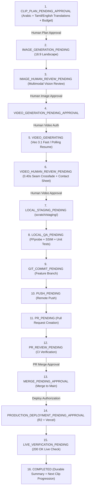

# 🎬 HuDa Web Quran — End-to-End Approval-Gated Video Production Skill

This skill guides the autonomous, resumable execution of the Surah video production lifecycle across all 114 Surahs inside the `huda-web-quran` repository.

> [!NOTE]
> **Activation & Discovery:** Antigravity discovers workspace skills located under `.agents/skills/<name>/SKILL.md`.
> This skill is loaded on-demand via progressive disclosure when triggered by relevant Surah video production tasks.

---

## 1. 16-State Workflow Architecture

Each video clip moves through the explicit, sequential, human-approved lifecycle states:



---

## 2. Next Clip Planning Engine

Before generating any image or spending credits, the orchestrator loads authoritative verse text from `public/data/quran-verses/<surahNumber>.json` and builds a complete plan:

* **Surah & Chapter Details:** Number, name, Arabic name, revelation classification.
* **Verse Boundaries:** Exact starting ayah (`fromVerse`) and ending ayah (`toVerse`).
* **Authoritative Text:**
  * Arabic rasm calligraphy (`textArabic`)
  * Tamil translation (`textTamil` - Jan Trust)
  * English translation (`textEnglish` - Saheeh International)
* **Thematic Scene Concept:** Documented natural landscape, stationary cinema camera, no humans, no idols, no buildings, no text.
* **Aspect Ratio & Resolution:** Native 16:9 widescreen tolerance `[1.72, 1.82]` at 1080p (or 1344×768 landscape).
* **Financial Projection:** Cost estimate vs. current ledger balance, maintaining the ₹600.00 INR hard-stop floor.

---

## 3. Command Reference & Mode Separation

### A. Verse Planning & Approval
```bash
# Preview verse plan for next clip with Arabic, Tamil, and English text:
node scripts/pipeline/surah-pipeline.mjs <surahNum> --plan-clip=<clipId>

# Record explicit human plan approval:
node scripts/pipeline/surah-pipeline.mjs <surahNum> --approve-plan --clip=<clipId> --notes="Plan confirmed"
```

### B. Image Generation & Review
```bash
# Generate still image preview candidate (mock / dry-run / live):
node scripts/pipeline/surah-pipeline.mjs <surahNum> --image-gen --live --clip=<clipId>

# Run multimodal AI visual review:
node scripts/pipeline/surah-pipeline.mjs <surahNum> --review-image --live --clip=<clipId>

# Record human image approval:
node scripts/pipeline/surah-pipeline.mjs <surahNum> --approve-image --clip=<clipId> --notes="Image approved"
```

### C. Video Generation & Polling Resumption
```bash
# Run controlled video generation with explicit operator approval:
node scripts/pipeline/surah-pipeline.mjs <surahNum> --pilot --live --clip=<clipId> --confirm=APPROVE

# Resume polling an existing interrupted operation (Zero duplicate spend):
node scripts/pipeline/surah-pipeline.mjs <surahNum> --poll-resume --clip=<clipId>

# Record human video approval:
node scripts/pipeline/surah-pipeline.mjs <surahNum> --approve-video --clip=<clipId> --notes="Video approved"
```

### D. Local Staging & QA
```bash
# Stage video non-destructively into scratch/staging/<NNN>/:
node scripts/pipeline/surah-pipeline.mjs <surahNum> --stage-local --clips=<clipId>

# Run composite QA and full unit test suite:
node scripts/pipeline/surah-pipeline.mjs <surahNum> --qa --clips=<clipId>
```

### E. Git, PR, and Release Stages
```bash
# Advance Git, PR, and deployment stages with explicit gates:
node scripts/pipeline/surah-pipeline.mjs <surahNum> --git-commit --clip=<clipId>
node scripts/pipeline/surah-pipeline.mjs <surahNum> --push-branch --clip=<clipId>
node scripts/pipeline/surah-pipeline.mjs <surahNum> --create-pr --clip=<clipId>
node scripts/pipeline/surah-pipeline.mjs <surahNum> --approve-merge --clip=<clipId>
node scripts/pipeline/surah-pipeline.mjs <surahNum> --deploy-prod --clip=<clipId>
node scripts/pipeline/surah-pipeline.mjs <surahNum> --verify-live --clip=<clipId>
```

---

## 4. Next Clip UX Protocol

When the user requests "Next":
1. Automatically determine the next eligible clip.
2. Present the detailed verse plan with Arabic text and verified Tamil and English meanings.
3. Halt and wait for explicit human plan approval (`CLIP_PLAN_PENDING_APPROVAL`).
4. Generate still image preview and run multimodal AI review (`IMAGE_HUMAN_REVIEW_PENDING`).
5. Halt and wait for explicit human image approval.
6. Request explicit video authorization, generate video, and process 0.40s seam (`VIDEO_HUMAN_REVIEW_PENDING`).
7. Halt and wait for explicit final video approval.
8. Stage locally, run QA, and advance through Git/PR/Release gates one by one.
