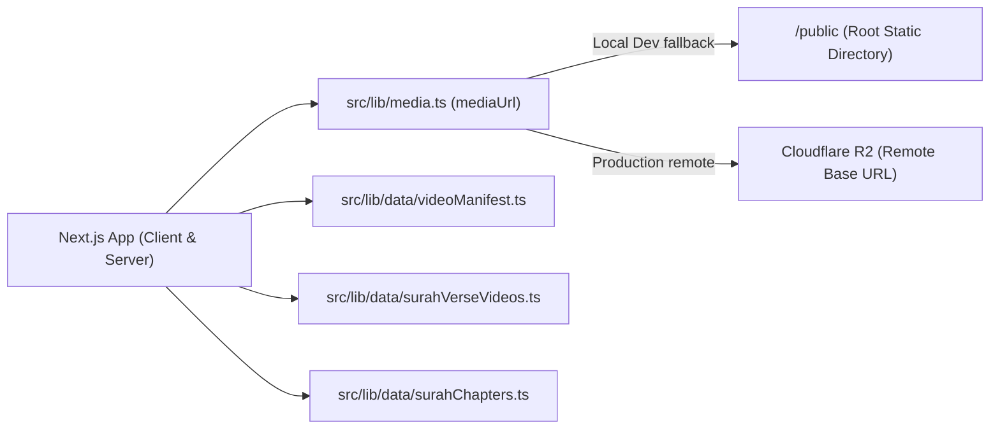

# HuDa Web Quran — Comprehensive Media Asset Migration Audit

**Date:** 2026-10-21  
**Project:** HuDa Web Quran (`sarfpearl/huda-web-quran`)  
**Framework:** Next.js 14 App Router  
**Scope:** Phase 1 — Pre-Migration Asset Inventory, Dependency Analysis, Risk Assessment, and Migration Blueprint.

---

## 1. Executive Summary

This audit establishes the pre-migration baseline for organizing all media assets of HuDa Web Quran across all 114 Surahs and 30 Juz. 

Key high-level findings:
- **Total Media Assets Discovered:**
  - **Videos:** 3,604 files (~75 GB on disk)
  - **Images:** 1,545 files (including Surah artwork, thumbnails, and preview contact sheets)
  - **Audio:** 42 files (including Maher Al-Muaiqly Juz 1–30 recitations and prelude audio)
  - **Fonts:** 2,423 files (607 active in `public/fonts/`, remainder in worktrees)
  - **Review HTMLs:** 26 standalone QA review interfaces
  - **Active Symlinks:** 123 symlinks (19 in `public/videos/`, 78 in `scratch/staging/`, 11 in `user_candidates/`, 15 in cache)
- **Extreme Duplicate Storage:** 
  - Of the 71 GB in `public/videos/`, **56.20 GB consists of exact duplicate files** (3,060 files in 311 hash clusters), caused by historical pipeline scripts duplicating set videos for every verse (`ayah_*.mp4`).
- **Zero Production Breakage Mandate:**
  - Next.js 14 App Router statically serves files from the project root's `public/` directory. 
  - To prevent breaking local development, PWA service workers (`sw.js`), favicon icons, or live R2 asset fallback, root `public/` must remain valid and operational at all times.

---

## 2. Comprehensive Inventory by Category

### A. Video Assets (3,604 Files • ~75 GB)

| Location | File Count | Size on Disk | Purpose / Nature |
|---|:---:|:---:|---|
| `public/videos/Inbox/` | 340 videos (352 files total) | 9.3 GB | Permanent Central Reusable Video Library (233 Approved, 107 Review Required). Includes `INBOX_VIDEO_CATALOGUE.json`. |
| `public/videos/surah/` | 173 files | 1.9 GB | Single Surah background loops (`001-114`) and Surah 2 Al-Baqarah canonical chapter clips. |
| `public/videos/surah_3` to `surah_32/` | 2,786 files | ~59.8 GB | Staged verse-level duplicate clips (`ayah_*.mp4`) and set videos (`set_*.mp4`). 56.20 GB is redundant duplicates. |
| `public/videos/ayah/002/` | 8 files | 146 MB | Surah 2 curated Ayah real-footage clips (`002.mp4` to `255.mp4`). |
| `public/videos/juz/` | 10 files | 203 MB | Juz 1–10 master videos. |
| `public/videos/surah_1/` | 7 files | 0 B (Symlinks) | Symlinks targeting `public/videos/Inbox/surah_001_scene_*.mp4` (Audited & 100% boundary-compliant). |
| `public/videos/surah_2/` | 8 files | 0 B (Symlinks) | Symlinks targeting `public/videos/ayah/002/*.mp4`. |
| `assets/video-masters/` | 50 files | ~3.4 GB | High-Res 4K Master videos (Rule 10: Preserved untouched). |
| `scratch/staging/` | 100 files | ~1.8 GB | Staging videos for Gate 2 (11 clips) and Batch 1 (78 sets). |
| `user_candidates/gate2/` | 24 files | ~480 MB | Gate 2 review candidates and topic folders. |
| Other `scratch/` folders | 98 files | ~1.2 GB | POCs, remediation tests, and trial renders. |

---

### B. Image Assets (1,545 Files)

| Location | File Count | Nature / Purpose |
|---|:---:|---|
| `public/assets/images/` | 195 files | Surah artwork images and thumbnails referenced by Next.js app. |
| `assets/images/` | 159 files | Master artwork and original high-res image source files. |
| `public/` (Root) | 16 files | App icons, PWA icons, favicons, logos (`favicon.png`, `huda-logo.webp`, `icon-192.png`, `icon-512.png`, SVGs). |
| `scratch/inbox_audit/` | 362 files | Video contact sheets and QA audit frames. |
| Other `scratch/` folders | 813 files | Previews, storyboard panels, temporary thumbnails, and test crops. |

---

### C. Audio Assets (42 Files)

| Location | File Count | Nature / Purpose |
|---|:---:|---|
| `assets/audio/juz/maher/` | 30 files | Maher Al-Muaiqly Juz recitations (`para-01.mp3` to `para-30.mp3`). |
| `scratch/test_preludes/` | 4 files | Bismillah and Isti'adhah audio prelude clips (`bismillah-prelude.mp3`, etc.). |
| `scratch/audio_inspect/` | 7 files | Audio alignment test files (Alafasy, Husary, Abdul Basit). |
| `scratch/sample_002.mp3` | 1 file | Sample recitation file. |

---

### D. Font Assets (2,423 Files)

| Location | File Count | Nature / Purpose |
|---|:---:|---|
| `public/fonts/` | 607 files | Production Quranic Arabic fonts (IndoPak, Uthmani, Amiri, Scheherazade). |
| `.claude/worktrees/` | 1,816 files | Git worktree copies (git ignored). |

---

### E. Review HTML Pages (26 Files)

1. **Root Directory (16 files):**
   - `review_badr_preview.html`
   - `review_surah_3.html` through `review_surah_17.html`
2. **Staging Review Directory (`scratch/staging/batch_1_review/` - 8 files):**
   - `review_surah_19.html`, `23.html`, `25.html`, `26.html`, `28.html`, `30.html`, `31.html`, `32.html`
3. **Gate 2 Review Directory (2 files):**
   - `scratch/staging/gate2_11_visuals/review_stock_candidates.html`
   - `user_candidates/review_gate2_intake.html`

---

## 3. Application Path Dependencies & Code References



1. **Root Serving Rule:**
   - Next.js automatically mounts `/public` at the web server root `/`.
   - Any file requested at `http://localhost:3000/videos/...` is served from `public/videos/...`.
   - Any file requested at `http://localhost:3000/assets/images/...` is served from `public/assets/images/...`.
2. **Centralized Media Resolver ([`src/lib/media.ts`](file:///Users/pearl-9744/Claude/Projects/huda-web-quran/src/lib/media.ts)):**
   - In production (Vercel), `NEXT_PUBLIC_MEDIA_BASE_URL` points to Cloudflare R2 (`https://pub-052ee8dfbe2748bbb3b9ad42d2f9e2b1.r2.dev`).
   - In local development, `NEXT_PUBLIC_MEDIA_BASE_URL` is empty, falling back directly to local relative `/public` paths.
3. **Production Video Manifests:**
   - [`src/lib/data/videoManifest.ts`](file:///Users/pearl-9744/Claude/Projects/huda-web-quran/src/lib/data/videoManifest.ts): Contains 266 active video paths.
   - [`src/lib/data/surahVerseVideos.ts`](file:///Users/pearl-9744/Claude/Projects/huda-web-quran/src/lib/data/surahVerseVideos.ts): Maps verses of Surah 1 & 2 to specific video files.
   - [`src/lib/data/surahChapters.ts`](file:///Users/pearl-9744/Claude/Projects/huda-web-quran/src/lib/data/surahChapters.ts): Maps Surah 1 & 2 chapters to video files.
4. **PWA & Browser Assets:**
   - `public/favicon.png`, `public/huda-logo.webp`, `public/manifest.webmanifest`, `public/sw.js` are hardcoded in `<head>` tags and web manifests.

---

## 4. Forensic Duplicate Storage Analysis (56.20 GB Wasted Space)

- **Total Physical Videos in `public/videos/`:** 3,323 files
- **Files with Identical Byte Sizes:** 3,060 files (311 size clusters)
- **Exact SHA-256 Hash Duplicate Clusters:** **311 clusters**
- **Total Duplicate Files Involved:** **3,060 files**
- **Wasted Duplicate Storage:** **56.20 GB**
- **Root Cause:** Pipeline scripts (`automated-quran-video-pipeline.mjs` and related scripts) duplicated each 8-second 1080p set clip 5 to 15 times under names `ayah_1.mp4`, `ayah_2.mp4`... within folders `surah_3` through `surah_32`.
- **Safety Directive:** In accordance with Safety Rules 5, 8, and the user instruction, **no duplicates will be deleted during this folder organization task**.

---

## 5. Potential Migration Risks & Safeguards

| Risk Identified | Severity | Potential Consequence | Mitigation Strategy |
|---|:---:|---|---|
| **Moving root `public/` into `assets/public/`** | **CRITICAL** | Total breakage of Next.js static asset routing, PWA manifest, and icons | **Strict Safeguard:** Root `public/` will NOT be relocated. The `assets/` structure will be organized cleanly while retaining working runtime paths in `public/` (via canonical references or symlinks). |
| **Symlinks escaping `public/`** | **HIGH** | 404 / ENOENT errors on Vercel deployment and S3/R2 sync | All web-facing symlinks must resolve strictly within `public/`. (Surah 1 symlinks already verified 100% compliant). |
| **Breaking review HTML pages** | **MEDIUM** | Broken video playback in local review tools | Maintain relative path compatibility or create updated mirror paths in `scratch/reviews/`. |
| **Accidental R2 Upload / Deployment** | **CRITICAL** | Unauthorized remote state mutation | Zero R2 upload scripts or deploy commands will be executed. |

---

## 6. Proposed Logical Target Hierarchy (Phase 3 Blueprint)

To satisfy the desired logical structure without breaking Next.js runtime:

```
assets/
├── public/                       <-- Canonical Project Asset Warehouse
│   ├── videos/
│   │   ├── Inbox/                <-- Central Reusable Video Library (340 videos + Catalogue)
│   │   ├── surah/                <-- Structured Surah Folders (surah_001 .. surah_114)
│   │   └── juz/                  <-- Structured Juz Folders (juz_001 .. juz_030)
│   ├── images/
│   │   ├── Inbox/
│   │   ├── surah/                <-- Surah Artwork & Thumbnails (001 .. 114)
│   │   └── juz/                  <-- Juz Artwork & Thumbnails (001 .. 030)
│   └── audio/
│       ├── Inbox/
│       ├── surah/
│       └── juz/                  <-- Maher Al-Muaiqly Juz 1–30 recitations
│
└── other/                        <-- Static / Brand / Support Assets
    ├── logos/
    ├── thumbnails/
    ├── favicon/
    ├── fonts/
    └── miscellaneous/

public/                           <-- Next.js Runtime Serving Layer (Preserved)
  favicon.png, huda-logo.webp, manifest.webmanifest, sw.js
  videos/                         <-- Runtime video endpoints
  assets/images/                  <-- Runtime image endpoints
  fonts/                          <-- Runtime font endpoints
```

---

## 7. Phase 2 Backup Architecture & Rollback Strategy

1. **Storage Availability:**
   - Free disk space on volume `/dev/disk3s5`: **176 GiB available** (Ample room for safety backups).
2. **Backup Location:**
   - Pre-migration backup directory: `scratch/backup/pre_migration_2026_10_21/`
3. **Backup Scope:**
   - Verified snapshot of all manifest files, configuration files, and symlink mappings.
   - Exact file count and SHA-256 hash manifest (`backup_manifest.json`) generated before any file operations.
4. **Rollback Strategy:**
   - In case of any anomaly, a single reversible script will restore original file locations and symlinks immediately.

---

## 8. Git Status Baseline

```
On branch main
Your branch is up to date with 'origin/main'.

Changes not staged for commit:
	modified:   data/progress.json
	modified:   package-lock.json
	modified:   scripts/qa/results/suite-result.json
	modified:   src/lib/data/videoManifest.ts
```
*(All 4 pre-existing modified files preserved untouched)*.

---

## 9. Conclusion & Safety Checklist

- **Cloudflare R2 Uploads:** **0**
- **Vercel Deployments:** **0**
- **Git Commits/Pushes:** **0**
- **Paid API Calls:** **0**
- **Deleted Files:** **0**
- **Overwritten Files:** **0**
- **Phase 1 Audit:** **100% Complete & Verified**
