# HuDa Web Quran — Phase 4B Staging Report (Surahs 104–114)

**Date:** 2026-10-22  
**Project:** HuDa Web Quran (`sarfpearl/huda-web-quran`)  
**Scope:** Phase 4B Limited Canonical Staging (Surahs 104 to 114)  
**Destination:** [`assets/public/videos/surah/`](file:///Users/pearl-9744/Claude/Projects/huda-web-quran/assets/public/videos/surah/)  
**Staging Ledger:** [`scratch/staging/phase4b_surahs_104_114/phase4b_staging_ledger.json`](file:///Users/pearl-9744/Claude/Projects/huda-web-quran/scratch/staging/phase4b_surahs_104_114/phase4b_staging_ledger.json)  
**Verification Status:** **100% VERIFIED — ALL 11 STAGED FILES MATCH SHA-256 WITH INDEPENDENT INODES**  
**Copy Method:** **ORDINARY FILE COPY (100% Source/Destination Independence)**  
**Safety Status:** **ZERO MODIFICATIONS TO ROOT `public/`, RUNTIME CODE, MANIFESTS, OR URLS**  
**TypeScript Status:** **Typecheck Clean (`tsc --noEmit` Exit 0)**  

---

## 1. Executive Summary

In accordance with Phase 4B authorization and explicit user decisions, a limited, non-destructive canonical staging was successfully completed for **Surahs 104 through 114** (Al-Humazah through An-Nas).

A total of **11 canonical background loop video files (75.10 MB / 78,748,564 bytes)** were copied from [`public/videos/surah/`](file:///Users/pearl-9744/Claude/Projects/huda-web-quran/public/videos/surah/) into their respective canonical directories in [`assets/public/videos/surah/`](file:///Users/pearl-9744/Claude/Projects/huda-web-quran/assets/public/videos/surah/).

### Key Engineering Decisions
1. **Copy Method Selection:** In compliance with user instructions ("Prefer ordinary file copies for this pilot unless disk-space constraints make hardlinks necessary"), all 11 files were transferred via **standard file copies** (`shutil.copy2`) rather than hardlinks. This guarantees that destination files possess **independent filesystem inodes** (`src_inode != dst_inode`), eliminating any risk of shared-data mutation.
2. **Review HTML Files Retention:** As decided by the user, `review_surah_16.html` and `review_surah_17.html` remain archived in [`Unused Items/review-html/`](file:///Users/pearl-9744/Claude/Projects/huda-web-quran/Unused%20Items/review-html/) and were not restored to the root directory.
3. **Zero Production Impact:** The live web application and local development server continue serving static assets directly from root `public/videos/surah/` without disruption.

```mermaid
flowchart TD
    subgraph Source["Verified Production Sources (public/videos/surah/)"]
        S104["104-al-humazah.mp4 (5.13 MB)"]
        S105["105-al-fil.mp4 (6.71 MB)"]
        S106["106-quraysh.mp4 (6.28 MB)"]
        S107["107-al-maun.mp4 (6.64 MB)"]
        S108["108-al-kawthar.mp4 (7.74 MB)"]
        S109["109-al-kafirun.mp4 (6.69 MB)"]
        S110["110-an-nasr.mp4 (6.53 MB)"]
        S111["111-al-masad.mp4 (3.82 MB)"]
        S112["112-al-ikhlas.mp4 (7.03 MB)"]
        S113["113-al-falaq.mp4 (7.67 MB)"]
        S114["114-an-nas.mp4 (10.87 MB)"]
    end

    subgraph Staging["Canonical Target (assets/public/videos/surah/)"]
        D104["assets/.../104-al-humazah/104-al-humazah.mp4"]
        D105["assets/.../105-al-fil/105-al-fil.mp4"]
        D106["assets/.../106-quraysh/106-quraysh.mp4"]
        D107["assets/.../107-al-maun/107-al-maun.mp4"]
        D108["assets/.../108-al-kawthar/108-al-kawthar.mp4"]
        D109["assets/.../109-al-kafirun/109-al-kafirun.mp4"]
        D110["assets/.../110-an-nasr/110-an-nasr.mp4"]
        D111["assets/.../111-al-masad/111-al-masad.mp4"]
        D112["assets/.../112-al-ikhlas/112-al-ikhlas.mp4"]
        D113["assets/.../113-al-falaq/113-al-falaq.mp4"]
        D114["assets/.../114-an-nas/114-an-nas.mp4"]
    end

    Source -->|Ordinary File Copy • Independent Inodes| Staging
    Staging --> Ledger["phase4b_staging_ledger.json (100% SHA-256 Verified)"]
```

---

## 2. Staged Files Inventory (Surahs 104–114)

All 11 files were copied into [`assets/public/videos/surah/`](file:///Users/pearl-9744/Claude/Projects/huda-web-quran/assets/public/videos/surah/) following the canonical zero-padded directory naming convention. Every destination file was verified against its source using SHA-256:

| Surah # | Surah Name | Source Path | Canonical Staging Destination | File Size | SHA-256 Checksum (Source & Destination) | Inode Separation | Status |
|:---:|---|---|---|:---:|---|:---:|:---:|
| **104** | Al-Humazah | `public/videos/surah/104-al-humazah.mp4` | [`assets/public/videos/surah/104-al-humazah/104-al-humazah.mp4`](file:///Users/pearl-9744/Claude/Projects/huda-web-quran/assets/public/videos/surah/104-al-humazah/104-al-humazah.mp4) | 5,378,855 B (5.13 MB) | `5153ee6450ae5f9393e185cf1fe186e8cb55447a16f8ffbb2c377d61c6b8bfd9` | Independent (`src: 19895066` &ne; `dst: 20739981`) | **VERIFIED MATCH** |
| **105** | Al-Fil | `public/videos/surah/105-al-fil.mp4` | [`assets/public/videos/surah/105-al-fil/105-al-fil.mp4`](file:///Users/pearl-9744/Claude/Projects/huda-web-quran/assets/public/videos/surah/105-al-fil/105-al-fil.mp4) | 7,040,312 B (6.71 MB) | `4831b27ec91a3ec14995f9c4642738a16dbd7831bb210164a2df8ea3b9e4a3df` | Independent (`src: 19895071` &ne; `dst: 20739983`) | **VERIFIED MATCH** |
| **106** | Quraysh | `public/videos/surah/106-quraysh.mp4` | [`assets/public/videos/surah/106-quraysh/106-quraysh.mp4`](file:///Users/pearl-9744/Claude/Projects/huda-web-quran/assets/public/videos/surah/106-quraysh/106-quraysh.mp4) | 6,583,914 B (6.28 MB) | `e4c6a93584226948a335756314f386c9ca35084930122e15da38686629ef7631` | Independent (`src: 19895076` &ne; `dst: 20739985`) | **VERIFIED MATCH** |
| **107** | Al-Maun | `public/videos/surah/107-al-maun.mp4` | [`assets/public/videos/surah/107-al-maun/107-al-maun.mp4`](file:///Users/pearl-9744/Claude/Projects/huda-web-quran/assets/public/videos/surah/107-al-maun/107-al-maun.mp4) | 6,959,137 B (6.64 MB) | `ead889273113ead25e5ec1562b78ce13b631d575ec54407b9a52862dff99596c` | Independent (`src: 19895081` &ne; `dst: 20739987`) | **VERIFIED MATCH** |
| **108** | Al-Kawthar | `public/videos/surah/108-al-kawthar.mp4` | [`assets/public/videos/surah/108-al-kawthar/108-al-kawthar.mp4`](file:///Users/pearl-9744/Claude/Projects/huda-web-quran/assets/public/videos/surah/108-al-kawthar/108-al-kawthar.mp4) | 8,118,402 B (7.74 MB) | `7534849ad30e0926a7eb42371a5c6896d84948bbef6df55490799863a326084d` | Independent (`src: 19895086` &ne; `dst: 20739989`) | **VERIFIED MATCH** |
| **109** | Al-Kafirun | `public/videos/surah/109-al-kafirun.mp4` | [`assets/public/videos/surah/109-al-kafirun/109-al-kafirun.mp4`](file:///Users/pearl-9744/Claude/Projects/huda-web-quran/assets/public/videos/surah/109-al-kafirun/109-al-kafirun.mp4) | 7,011,094 B (6.69 MB) | `d5bf0323fd355dbbebbd2bb49339e1448b1bfb91763aa70162ccf7d046fbf8ee` | Independent (`src: 19895091` &ne; `dst: 20739991`) | **VERIFIED MATCH** |
| **110** | An-Nasr | `public/videos/surah/110-an-nasr.mp4` | [`assets/public/videos/surah/110-an-nasr/110-an-nasr.mp4`](file:///Users/pearl-9744/Claude/Projects/huda-web-quran/assets/public/videos/surah/110-an-nasr/110-an-nasr.mp4) | 6,845,080 B (6.53 MB) | `2c2b5447c838327b87834a362ffb0cb334f6e1f0e42d7658c1c5ce48e24fa2eb` | Independent (`src: 19895096` &ne; `dst: 20739993`) | **VERIFIED MATCH** |
| **111** | Al-Masad | `public/videos/surah/111-al-masad.mp4` | [`assets/public/videos/surah/111-al-masad/111-al-masad.mp4`](file:///Users/pearl-9744/Claude/Projects/huda-web-quran/assets/public/videos/surah/111-al-masad/111-al-masad.mp4) | 4,005,511 B (3.82 MB) | `59394f701a29870e28f323c6f605f6cecfce49b78e3f9a7aa769a0a1f9e29f34` | Independent (`src: 19895101` &ne; `dst: 20739995`) | **VERIFIED MATCH** |
| **112** | Al-Ikhlas | `public/videos/surah/112-al-ikhlas.mp4` | [`assets/public/videos/surah/112-al-ikhlas/112-al-ikhlas.mp4`](file:///Users/pearl-9744/Claude/Projects/huda-web-quran/assets/public/videos/surah/112-al-ikhlas/112-al-ikhlas.mp4) | 7,373,279 B (7.03 MB) | `75b29da0395edb7c050a41dcf966fcfa576fb0d2a93902324f60f64be8fb61dc` | Independent (`src: 19895106` &ne; `dst: 20739997`) | **VERIFIED MATCH** |
| **113** | Al-Falaq | `public/videos/surah/113-al-falaq.mp4` | [`assets/public/videos/surah/113-al-falaq/113-al-falaq.mp4`](file:///Users/pearl-9744/Claude/Projects/huda-web-quran/assets/public/videos/surah/113-al-falaq/113-al-falaq.mp4) | 8,039,442 B (7.67 MB) | `16ef8e90dd06595ee367d32c91cf95e54d89cbdf58c19958bc6e3bb6bf4c0be2` | Independent (`src: 19895111` &ne; `dst: 20739999`) | **VERIFIED MATCH** |
| **114** | An-Nas | `public/videos/surah/114-an-nas.mp4` | [`assets/public/videos/surah/114-an-nas/114-an-nas.mp4`](file:///Users/pearl-9744/Claude/Projects/huda-web-quran/assets/public/videos/surah/114-an-nas/114-an-nas.mp4) | 11,393,538 B (10.87 MB) | `0cbe49ac165999d968840c832791771f280a969f16d1f936ae229b0f47c23a75` | Independent (`src: 19895116` &ne; `dst: 20740001`) | **VERIFIED MATCH** |

**Total Staged Data:** **11 files • 78,748,564 bytes (~75.10 MB)**

---

## 3. Explicit Exclusions & Provenance Log

In accordance with safety limits, candidate assets that do not represent canonical production background loops for Surahs 104–114 were strictly excluded:

1. **Central Inbox Asset Copies (11 files in `public/videos/Inbox/`):**
   - Files: `public/videos/Inbox/104-al-humazah.mp4` through `114-an-nas.mp4`.
   - Reason for Exclusion: Protected central reusable repository. Preserved in Inbox without copying or modification per Rule 3B.
2. **Unapproved Scratch Storyboard Explorations (`scratch/surah_114_video3/`):**
   - Files: 3 video drafts (`03a-earth-from-space.mp4`, `03b-ocean-sunset.mp4`, `03c-green-mountain-valley.mp4`) and 26 QA frame images.
   - Reason for Exclusion: Unapproved experimental renders. Excluded from canonical staging.
3. **Audit Thumbnails in Scratch (`scratch/inbox_audit/thumbs/`):**
   - Files: `103078-662114109_t1.jpg`, `_t2.jpg`, `_t3.jpg`.
   - Reason for Exclusion: Temporary audit artifacts. Excluded.
4. **Phase 4A Staging Workspace (`scratch/staging/phase4a_trial/114-an-nas/`):**
   - Staged in Phase 4A isolated trial directory. Retained there untouched as part of the Phase 4A trial record.

---

## 4. Post-Staging Validation & System Integrity

Following the staging of the 11 canonical files, the complete repository verification was re-executed:

| Verification Dimension | Expected State | Verified State | Status |
|---|:---:|:---:|:---:|
| **Staged Files SHA-256 Checksum** | 100% Match with Source | 11/11 Files Matched (`0 Mismatches`) | **PASSED** |
| **Inode Independence** | `src_inode != dst_inode` | 11/11 Verified Independent Copies | **PASSED** |
| **Original Production Sources** | 100% Unchanged | Identical Sizes, Hashes & Inodes | **PASSED** |
| **Inbox Catalogue Checksum** | `d63d5808...` | Matches Backup Byte-for-Byte | **PASSED** |
| **Approved Inbox Library** | 233 clips | 233/233 Present & Unmodified | **PASSED** |
| **Review Required Stock Clips** | 107 clips | 107/107 Preserved in Inbox | **PASSED** |
| **4K Video Masters** | 70 files (2.71 GB) | 70/70 Intact in `assets/video-masters/` | **PASSED** |
| **Workspace Symlinks** | 123 symlinks | 123/123 Matched Against Snapshot | **PASSED** |
| **Canonical Surah 2 Folder** | 62 items intact | 62/62 Items Intact (`002-al-baqarah/`) | **PASSED** |
| **Secondary Surah 2 Folders** | 8 files / 8 links | 100% Intact (`ayah/002/` & `surah_2/`) | **PASSED** |
| **Phase 4A Staging Trial** | 73 items intact | 73/73 Items Intact in `phase4a_trial/` | **PASSED** |
| **TypeScript Compilation** | Exit code 0 | `npm run typecheck` Exit 0 | **PASSED** |
| **Git Working Tree Noise** | 0 untracked files added | Clean (`/assets` ignored by `.gitignore`) | **PASSED** |

---

## 5. Conclusion & Stop Condition

Phase 4B has successfully established the canonical background loop staging for **Surahs 104 through 114** in [`assets/public/videos/surah/`](file:///Users/pearl-9744/Claude/Projects/huda-web-quran/assets/public/videos/surah/).

- All 11 files are verified, independent, and bit-for-bit identical to their production sources.
- No production URLs, manifests, or runtime behaviors were modified.
- Root `public/` continues serving all static assets without modification.

**In accordance with the execution protocol, all operations have ceased. Stopping and waiting for user review.**
