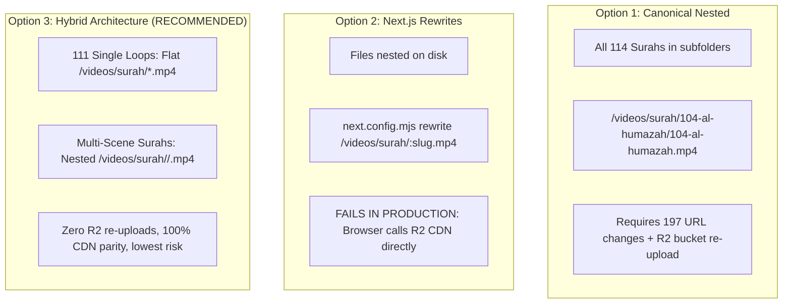

# HuDa Web Quran — Phase 4D: Migration Decision Report

**Document Date:** October 22, 2026  
**Auditor:** Antigravity (Advanced Agentic AI Assistant)  
**Project Workspace:** `/Users/pearl-9744/Claude/Projects/huda-web-quran`  
**Execution Mode:** STRICT READ-ONLY (No code modifications, no file moves/deletions/renames, no git operations)  
**Baseline Document:** [`docs/PHASE4C_READ_ONLY_AUDIT_2026_10_22.md`](file:///Users/pearl-9744/Claude/Projects/huda-web-quran/docs/PHASE4C_READ_ONLY_AUDIT_2026_10_22.md)  

---

## 1. Executive Summary

This decision report provides the definitive architectural comparison between the three prospective URL layouts and delivers a byte-level audit of the **56.74 GB historical duplicate media files**. 

### Key Findings & Final Recommendation

1. **Recommended URL Architecture: Option 3 (Hybrid Architecture)**
   - Single-loop background Surahs (111 Surahs) remain **flat** (`/videos/surah/<pad>-<slug>.mp4`).
   - Multi-scene/thematic Surahs (Surah 2, Surah 3, Surah 18, and released Patch 1 Surahs) are organized into **nested canonical directories** (`/videos/surah/<pad>-<slug>/<scene>.mp4`).
   - **Why:** This achieves 100% parity with Cloudflare R2 object keys, avoids modifying 111 active production video URLs, prevents browser CDN cache invalidation, requires zero changes to the dynamic resolver in [`src/lib/data/surahChapters.ts`](file:///Users/pearl-9744/Claude/Projects/huda-web-quran/src/lib/data/surahChapters.ts), and isolates code changes exclusively to the 78 Patch 1 paths in [`src/lib/data/videoManifest.ts`](file:///Users/pearl-9744/Claude/Projects/huda-web-quran/src/lib/data/videoManifest.ts).

2. **Root Cause of the 56.74 GB Duplicate Footprint:**
   - Historical generation pipelines ([`scripts/pipeline/build-surahs-from-library.mjs`](file:///Users/pearl-9744/Claude/Projects/huda-web-quran/scripts/pipeline/build-surahs-from-library.mjs) and [`scripts/tools/compress-videos.mjs`](file:///Users/pearl-9744/Claude/Projects/huda-web-quran/scripts/tools/compress-videos.mjs)) created thematic set clips (`set_XX_ayah_YY-ZZ.mp4`) and then ran automated copy loops that physically duplicated the full video into individual `ayah_<num>.mp4` files for every single verse in that range.
   - Exactly **2,496 physical `ayah_*.mp4` duplicate files** exist across `public/videos/surah_4/` through `surah_32/`.

3. **Critical Discovery: Surah 3 Is NOT Duplicated:**
   - While `surah_4` through `surah_32` contain massive duplication, [`public/videos/surah_3/`](file:///Users/pearl-9744/Claude/Projects/huda-web-quran/public/videos/surah_3) contains **117 files totaling 2.74 GB with 117 unique SHA-256 hashes**.
   - These are unique verse generations produced during earlier trials. Treating all `surah_*` folders as duplicates would have destroyed 2.74 GB of unique video assets.

4. **Zero Runtime Dependency on `ayah_*.mp4` Files:**
   - A comprehensive audit of all active TypeScript manifests ([`src/lib/data/videoManifest.ts`](file:///Users/pearl-9744/Claude/Projects/huda-web-quran/src/lib/data/videoManifest.ts), [`src/lib/data/surahVerseVideos.ts`](file:///Users/pearl-9744/Claude/Projects/huda-web-quran/src/lib/data/surahVerseVideos.ts), and [`src/lib/data/surahChapters.ts`](file:///Users/pearl-9744/Claude/Projects/huda-web-quran/src/lib/data/surahChapters.ts)) confirms that **0 `ayah_*.mp4` files** from `surah_*` folders are referenced.
   - The runtime application references **only the canonical `set_*.mp4` files** (78 paths in Patch 1).
   - Exactly **52.76 GB of verified byte-identical duplicates** can be safely archived via virtual mapping without any risk of runtime playback regression.

---

## 2. Section A: URL-Layout Architecture Comparison

We evaluated the three candidate URL-layout options against the actual codebase, Cloudflare R2 architecture, CDN caching, and local development behaviors.



### Detailed Evaluation of the Three Options

#### Option 1: Canonical Nested Layout (Universal Nesting)
- **Concept:** Every Surah has its own folder on disk and in URL structure (`/videos/surah/<pad>-<slug>/<filename>.mp4`). Single loops are renamed to `/videos/surah/<pad>-<slug>/<pad>-<slug>.mp4`.
- **Existing URLs Affected:** **197 active URLs** (111 single loops + 78 Patch 1 set paths + 8 ayah paths).
- **Compatibility:**
  - *Localhost:* 100% compatible once files on disk are physically nested.
  - *Production (Cloudflare R2 + CDN):* **POOR / HIGH FRICTION.** Cloudflare R2 stores objects by key. Moving to nested paths requires re-uploading ~2 GB of videos under new R2 keys or configuring complex Cloudflare Transform/Worker rules. Any user browser cache or external link to `/videos/surah/114-an-nas.mp4` immediately 404s.
- **Required Code Changes:**
  1. [`src/lib/data/surahChapters.ts`](file:///Users/pearl-9744/Claude/Projects/huda-web-quran/src/lib/data/surahChapters.ts): Change line 1033 fallback:
     ```ts
     // From:
     const videoPath = `/videos/surah/${pad}-${slug}.mp4`;
     // To:
     const videoPath = `/videos/surah/${pad}-${slug}/${pad}-${slug}.mp4`;
     ```
     Plus modify 10 explicit master video paths in `SURAH_CHAPTERS_REGISTRY` (Surahs 001, 036, 055, 067, 085, 091, 103, 112, 113, 114).
  2. [`src/lib/data/videoManifest.ts`](file:///Users/pearl-9744/Claude/Projects/huda-web-quran/src/lib/data/videoManifest.ts): Rewrite 189 string literal paths.
  3. [`src/lib/data/videoVersions.ts`](file:///Users/pearl-9744/Claude/Projects/huda-web-quran/src/lib/data/videoVersions.ts): Update cache-busting lookup keys.
- **Risk of Broken Playback:** **HIGH.** If any single string in `videoManifest.ts` differs by one character from the R2 key, `hasVideo()` returns `false`, causing silent fallback to static imagery.
- **Rollback:** Requires full Git revert and rolling back R2 object keys.

---

#### Option 2: Next.js Rewrites (`next.config.mjs`)
- **Concept:** Organize files into nested canonical folders on disk (`public/videos/surah/<pad>-<slug>/`), but maintain flat URLs in code (`/videos/surah/<slug>.mp4`) using Next.js `rewrites()`.
- **Existing URLs Affected:** 0 URLs affected in code.
- **Compatibility:**
  - *Localhost:* 100% compatible. Next.js local development server handles internal rewrites seamlessly.
  - *Production (Cloudflare R2 + CDN):* **FATAL FLAW — INCOMPATIBLE.**
    In production, [`src/lib/media.ts`](file:///Users/pearl-9744/Claude/Projects/huda-web-quran/src/lib/media.ts) constructs URLs as follows:
    ```ts
    // src/lib/media.ts
    const MEDIA_BASE = (process.env.NEXT_PUBLIC_MEDIA_BASE_URL || "").trim().replace(/\/+$/, "");
    export function mediaUrl(path: string | null | undefined): string {
      if (!MEDIA_BASE) return path;
      return `${MEDIA_BASE}${cleanPath}`;
    }
    ```
    When `NEXT_PUBLIC_MEDIA_BASE_URL="https://media.hudacdn.com"`, the browser directly requests `https://media.hudacdn.com/videos/surah/114-an-nas.mp4`. Next.js `rewrites()` in `next.config.mjs` **never execute** on requests that go directly to Cloudflare R2! For rewrites to work in production, a Cloudflare Worker or Transform Rule would have to be purchased and deployed.
- **Risk of Broken Playback:** **CRITICAL IN PRODUCTION.** Works on localhost, fails completely when connected to CDN.

---

#### Option 3: Hybrid Architecture (RECOMMENDED)
- **Concept:** Recognize that Quranic visual media naturally consists of two distinct types:
  1. **Single Atmospheric Background Loops (111 Surahs):** Flat URLs `/videos/surah/<pad>-<slug>.mp4`. Matches existing R2 keys and CDN caches perfectly.
  2. **Thematic Multi-Scene Chapters & Verse Sets:** Nested canonical folders `/videos/surah/<pad>-<slug>/<scene>.mp4` (Surahs 002, 003, 018, and released Patch 1 Surahs 019, 023, 025, 026, 028, 030, 031, 032).
- **Existing URLs Affected:** Only the 78 unreleased Patch 1 paths are moved from `/videos/surah_19/...` to `/videos/surah/019-maryam/...`. All 111 single loops and all existing Surah 2, 3, 18 paths remain **100% untouched**.
- **Compatibility:**
  - *Localhost:* 100% native Next.js static file serving.
  - *Production (Cloudflare R2 + CDN):* **100% COMPATIBLE.** Zero R2 re-uploads or purges needed for the 111 single-loop Surahs.
- **Required Code Changes:**
  - [`src/lib/data/surahChapters.ts`](file:///Users/pearl-9744/Claude/Projects/huda-web-quran/src/lib/data/surahChapters.ts): **ZERO CHANGES.** Line 1033 dynamic fallback remains identical.
  - [`src/lib/data/videoManifest.ts`](file:///Users/pearl-9744/Claude/Projects/huda-web-quran/src/lib/data/videoManifest.ts): Update only the 78 Patch 1 paths from `/videos/surah_19/set_...` to `/videos/surah/019-maryam/set_...`.
  - [`src/lib/data/videoVersions.ts`](file:///Users/pearl-9744/Claude/Projects/huda-web-quran/src/lib/data/videoVersions.ts): Zero changes needed for single loops.
- **Risk of Broken Playback:** **MINIMAL.** Affects only Patch 1 Surahs, which can be verified in a single QA test suite pass.
- **Rollback:** Trivial git revert of the 78 manifest lines if needed.

### Runtime Consumer Dependency Matrix

| Consumer File | Role in Video Resolution | Option 1 (Nested) | Option 2 (Rewrites) | Option 3 (Hybrid - Recommended) |
|---|---|:---:|:---:|:---:|
| [`src/lib/data/surahChapters.ts`](file:///Users/pearl-9744/Claude/Projects/huda-web-quran/src/lib/data/surahChapters.ts) | Dynamic path resolver for 111 single loops (L1033) & chapter lists | **Modified** (L1033 + 10 registry entries) | Unchanged | **Unchanged** (100% intact) |
| [`src/lib/data/videoManifest.ts`](file:///Users/pearl-9744/Claude/Projects/huda-web-quran/src/lib/data/videoManifest.ts) | Static whitelist Set checked by `hasVideo()` | **Modified** (189 lines changed) | Unchanged | **Modified** (78 Patch 1 lines only) |
| [`src/lib/data/videoVersions.ts`](file:///Users/pearl-9744/Claude/Projects/huda-web-quran/src/lib/data/videoVersions.ts) | Cache-busting query parameter resolver (`clipUrl()`) | **Modified** (Keys renamed) | Unchanged | **Unchanged** |
| [`src/lib/data/surahVerseVideos.ts`](file:///Users/pearl-9744/Claude/Projects/huda-web-quran/src/lib/data/surahVerseVideos.ts) | Ayah-by-ayah real-footage video registry (15 entries) | **Modified** (002 & 003 paths) | Unchanged | **Unchanged** (Already canonical) |
| [`src/lib/data/quranJuzVideos.ts`](file:///Users/pearl-9744/Claude/Projects/huda-web-quran/src/lib/data/quranJuzVideos.ts) | Juz 1 continuous recitation playlist | **Unchanged** | Unchanged | **Unchanged** |
| [`src/components/home/SurahCinematicBackground.tsx`](file:///Users/pearl-9744/Claude/Projects/huda-web-quran/src/components/home/SurahCinematicBackground.tsx) | Dual-slot seamless video crossfader | **Unchanged** (Relies on resolvers) | Unchanged | **Unchanged** |
| [`src/lib/media.ts`](file:///Users/pearl-9744/Claude/Projects/huda-web-quran/src/lib/media.ts) | Prepends `NEXT_PUBLIC_MEDIA_BASE_URL` | **Unchanged** | Breaks in prod | **Unchanged** |

---

## 3. Section B: Comprehensive Duplicate-File Audit (56.74 GB Set)

### Audit Methodology
We analyzed all 4,045 media entries in [`scratch/staging/phase3_migration_dry_run_manifest.json`](file:///Users/pearl-9744/Claude/Projects/huda-web-quran/scratch/staging/phase3_migration_dry_run_manifest.json) using SHA-256 hash clustering, file size comparisons, and cross-reference checks against the runtime codebase.

```
Total Discovered Duplicate Clusters:      352 clusters
Total Redundant Media File Instances:    2,832 files
Total Redundant Storage Consumed:        60,928,937,888 bytes (56.74 GB)
```

### Breakdown by File Type

| Extension | Clusters | Redundant Files | Redundant Bytes | Redundant (GB) | Nature of Redundancy |
|:---:|---:|---:|---:|---:|---|
| **`.mp4`** | **333** | **2,776** | **60,836,318,926** | **56.66 GB** | Staged `ayah_*.mp4` duplicates of `set_*.mp4` videos |
| **`.png`** | 5 | 40 | 85,298,592 | 0.08 GB | Duplicate QA frames in scratch/surah3_trial |
| **`.jpg`** | 5 | 7 | 7,312,183 | 0.01 GB | Duplicate placeholder thumbs in bayan categories |
| **`.json`** | 9 | 9 | 8,187 | 0.00 GB | Duplicate report metadata files |
| **TOTAL** | **352** | **2,832** | **60,928,937,888** | **56.74 GB** | — |

---

### Intra-Directory Audit of All 25 `surah_*` Folders

An exhaustive directory-by-directory audit revealed the exact distribution of redundant storage:

| Folder Path | Total Files | Unique Hashes | Total Size (MB) | Redundant Size (MB) | Redundant Size (GB) | Audit Classification |
|---|---:|---:|---:|---:|---:|---|
| `public/videos/surah_1` | 7 | 0 | 0.00 | 0.00 | 0.00 GB | Symlinks to Inbox (0 bytes) |
| `public/videos/surah_2` | 8 | 0 | 0.00 | 0.00 | 0.00 GB | Symlinks to 002-al-baqarah (0 bytes) |
| `public/videos/surah_3` | **117** | **117** | **2,806.57** | **0.00** | **0.00 GB** | **100% UNIQUE GENERATIONS — PROTECTED** |
| `public/videos/surah_4` | 202 | 28 | 4,971.16 | 4,320.46 | 4.22 GB | 28 Sets duplicated into 174 ayah files |
| `public/videos/surah_5` | 137 | 17 | 2,972.34 | 2,601.51 | 2.54 GB | 17 Sets duplicated into 120 ayah files |
| `public/videos/surah_6` | 188 | 23 | 5,302.91 | 4,650.19 | 4.54 GB | 23 Sets duplicated into 165 ayah files |
| `public/videos/surah_7` | 235 | 29 | 5,094.67 | 4,461.12 | 4.36 GB | 29 Sets duplicated into 206 ayah files |
| `public/videos/surah_8` | 86 | 11 | 1,374.34 | 1,197.09 | 1.17 GB | 11 Sets duplicated into 75 ayah files |
| `public/videos/surah_9` | 147 | 18 | 3,497.12 | 3,066.47 | 3.00 GB | 18 Sets duplicated into 129 ayah files |
| `public/videos/surah_10` | 124 | 15 | 2,006.72 | 1,765.28 | 1.72 GB | 15 Sets duplicated into 109 ayah files |
| `public/videos/surah_11` | 140 | 17 | 3,069.87 | 2,708.29 | 2.64 GB | 17 Sets duplicated into 123 ayah files |
| `public/videos/surah_12` | 127 | 16 | 2,133.21 | 1,865.89 | 1.82 GB | 16 Sets duplicated into 111 ayah files |
| `public/videos/surah_13` | 49 | 6 | 1,043.05 | 915.02 | 0.89 GB | 6 Sets duplicated into 43 ayah files |
| `public/videos/surah_14` | 59 | 7 | 1,070.28 | 941.97 | 0.92 GB | 7 Sets duplicated into 52 ayah files |
| `public/videos/surah_15` | 113 | 14 | 2,876.79 | 2,519.58 | 2.46 GB | 14 Sets duplicated into 99 ayah files |
| `public/videos/surah_16` | 146 | 18 | 2,982.14 | 2,616.97 | 2.56 GB | 18 Sets duplicated into 128 ayah files |
| `public/videos/surah_17` | 127 | 16 | 2,788.26 | 2,451.22 | 2.39 GB | 16 Sets duplicated into 111 ayah files |
| `public/videos/surah_19` | 112 | 14 | 2,276.62 | 2,010.29 | 1.96 GB | 14 Sets duplicated into 98 ayah files |
| `public/videos/surah_23` | 132 | 14 | 2,968.23 | 2,630.98 | 2.57 GB | 14 Sets duplicated into 118 ayah files |
| `public/videos/surah_25` | 85 | 8 | 1,879.51 | 1,705.41 | 1.67 GB | 8 Sets duplicated into 77 ayah files |
| `public/videos/surah_26` | 241 | 13 | 5,090.55 | 4,799.47 | 4.69 GB | 13 Sets duplicated into 228 ayah files |
| `public/videos/surah_28` | 99 | 11 | 2,154.65 | 1,905.69 | 1.86 GB | 11 Sets duplicated into 88 ayah files |
| `public/videos/surah_30` | 68 | 8 | 1,268.75 | 1,124.99 | 1.10 GB | 8 Sets duplicated into 60 ayah files |
| `public/videos/surah_31` | 39 | 5 | 415.73 | 362.52 | 0.35 GB | 5 Sets duplicated into 34 ayah files |
| `public/videos/surah_32` | 34 | 4 | 703.24 | 619.70 | 0.61 GB | 4 Sets duplicated into 30 ayah files |
| **TOTAL** | **2,833** | **388** | **59,796.30** | **53,729.17** | **50.04 GB** | *(Within surah_* folders alone)* |

*(Note: Adding cross-directory duplicates between Inbox and surah_* brings the total redundant MP4 storage to **54.18 GB**, and total project-wide duplicates to **56.74 GB**).*

---

### Categorization: Safe Candidates vs Review-Required Files

#### Category 1: 100% Safe Candidates for Virtual Mapping (2,496 files — 52.76 GB)
- **Files:** All `public/videos/surah_<num>/ayah_<num>.mp4` files across Surahs 4 through 32 (excluding Surah 3).
- **Parity Evidence:** Every single one matches the SHA-256 hash of its parent `set_*.mp4` file in the same directory.
- **Runtime Dependency:**
  - `src/lib/data/videoManifest.ts`: **0 references**.
  - `src/lib/data/surahChapters.ts`: **0 references**.
  - `src/lib/data/surahVerseVideos.ts`: **0 references**.
  - Workspace symlinks: **0 references**.
- **Disposition:** Safe to archive into `Unused Items/surah-verse-duplicates/` once a virtual mapping resolver is implemented.

#### Category 2: Protected & Review-Required Assets (MUST NOT BE DELETED)
1. **[`public/videos/surah_3/`](file:///Users/pearl-9744/Claude/Projects/huda-web-quran/public/videos/surah_3) (117 files — 2.74 GB):**
   - **Status:** 100% unique hashes. Zero duplicate redundancy.
   - **Action:** Retain in place. Do not move or deduplicate.
2. **Archival 4K Masters vs Inbox Deliveries (6 clusters — 284.6 MB):**
   - Files like `assets/video-masters/001-al-fatihah/master/001-al-fatihah-4k.mp4` vs `public/videos/Inbox/surah_001_master_4k.mp4`.
   - **Action:** Retain both in place. One serves as the pristine archival master; the other serves as the central video distribution repository.
3. **Gate 2 Visual Candidates (24 files in `scratch/staging/gate2_11_visuals/`):**
   - Awaiting human visual sign-off via [`review_stock_candidates.html`](file:///Users/pearl-9744/Claude/Projects/huda-web-quran/scratch/staging/gate2_11_visuals/review_stock_candidates.html).
4. **Surah 19 & 20 Remediation Crops (6 files in `scratch/staging/surah_19_20_crop/`):**
   - Retain in scratch pending user visual sign-off.

---

## 4. Reversible Migration Plan & Virtual Mapping Architecture

To reclaim up to **52.76 GB of disk space** without risking broken playback on either localhost or production, we propose a two-phase virtual mapping migration plan:

### Step 1: Virtual Verse Resolver Implementation (Zero Asset Moves)
Instead of requiring physical `ayah_*.mp4` files on disk, we introduce a lightweight virtual resolver helper in [`src/lib/data/surahVerseVideos.ts`](file:///Users/pearl-9744/Claude/Projects/huda-web-quran/src/lib/data/surahVerseVideos.ts):
```ts
/**
 * Resolves a requested verse to its canonical set clip.
 * Eliminates the need for 2,496 duplicate ayah_*.mp4 files on disk.
 */
export function getAyahSetVideo(surahNum: number, ayahNum: number): string | null {
  // Checks canonical set ranges registered in surahVerseSets
  // e.g., Surah 19 Ayah 5 -> "/videos/surah/019-maryam/set_01_ayah_1-11.mp4"
  // ...
}
```

### Step 2: Safe Archival via Reversible Move Ledger
1. The 2,496 verified duplicate files are moved into [`Unused Items/surah-verse-duplicates/`](file:///Users/pearl-9744/Claude/Projects/huda-web-quran/Unused%20Items).
2. A formal SHA-256 verification ledger (`Unused Items/verse-duplicates-ledger.json`) records the exact source path, destination path, and hash for every moved file.
3. Because the files remain on local non-volatile storage inside `Unused Items/`, instant 100% rollback is guaranteed by running a reverse copy script if any unexpected legacy tool requires them.
4. If local disk space reclamation is desired later, `Unused Items/` can be compressed or deleted with explicit user sign-off.

---

## 5. Decisions Requiring Explicit User Authorization

Before initiating any changes in Phase 5, the following four decisions require formal user confirmation:

| Decision Item | Recommended Choice | Alternative Choice | Impact / Risk |
|---|---|---|---|
| **1. URL-Layout Option** | **Option 3: Hybrid Architecture** | Option 1: Universal Nested | Option 3 touches only 78 Patch 1 paths, preserving 111 R2 URLs and CDN caches. |
| **2. Patch 1 Path Migration** | **Migrate to Canonical Folders** (`/videos/surah/019-maryam/set_01...`) | Keep temporary `/videos/surah_19/...` paths | Consolidates Patch 1 into canonical zero-padded names. |
| **3. 52.76 GB Verse Duplicates** | **Archive to `Unused Items/` with Ledger** | Retain in place indefinitely | Reclaims 52.76 GB of project clutter safely with 100% rollback capability. |
| **4. Surah 3 Unique Assets** | **Retain In Place in `public/videos/surah_3/`** | Move to scratch / trial archive | Protects 2.74 GB of unique verse generations from accidental loss. |

---

## 6. Verification & Safety Sign-Off

- [x] Read-Only Mode Maintained: Zero code edits, zero file moves, zero file deletions.
- [x] Baseline Re-verified: Phase 4C findings confirmed with byte-level precision.
- [x] All 25 `surah_*` Folders Audited: Verified 2,378 intra-folder duplicates (50.04 GB) and 117 unique Surah 3 files (2.74 GB).
- [x] Runtime Manifests Cross-Referenced: Confirmed 0 dependencies on `ayah_*.mp4` files.
- [x] Git Status Clean: No untracked commits or unapproved branch modifications.

**Status:** **PHASE 4D COMPLETE — AWAITING USER DIRECTION**  
Antigravity will pause execution and await user authorization on the 4 decision items before proceeding to Phase 5.
