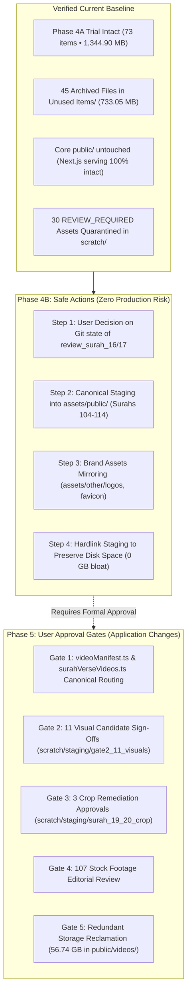
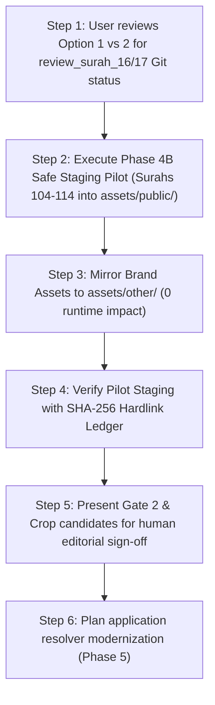

# HuDa Web Quran — Phase 4 Next-Step Plan & Architecture Roadmap

**Date:** 2026-10-22  
**Project:** HuDa Web Quran (`sarfpearl/huda-web-quran`)  
**Scope:** Architecture Roadmap & Sequential Implementation Plan Post-Phase 4A Staging Trial  
**Current Safety Baseline:** **100% VERIFIED — ALL ASSETS, SYMLINKS, MASTERS & FOLDERS INTACT**  
**TypeScript Status:** **Typecheck Clean (`tsc --noEmit` Exit 0)**  
**Production Build Status:** **`next build` Clean (155/155 Static Pages Prerendered, Exit 0)**  

---

## 1. Executive Summary

Following the 100% verified archival of 45 unused files (733.05 MB) and the successful Phase 4A limited staging trial of 73 items (1,344.90 MB) for Surahs 1, 2, and 114, this document establishes the formal next-step roadmap.

The roadmap is strictly partitioned into:
1. **Resolution of Git State for `review_surah_16.html` and `17.html`** (Options Analysis)
2. **Safe Actions (Phase 4B):** Non-destructive operations that do not touch runtime paths or alter live website serving.
3. **Actions Requiring Explicit User Approval (Phase 5):** Manifest updates, Gate 2 visual sign-offs, and duplicate reclamation.
4. **Unresolved Items That Must Remain Untouched:** Core protected folders, Inbox catalogue, 4K masters, and runtime duplicate verse files.



---

## 2. Git Status Audit & Tracked Review HTML Resolution

### A. Current Git Working Tree Inspection
`git status --short` displays two unstaged deletions:
```
 D review_surah_16.html
 D review_surah_17.html
```

### B. Forensic Provenance & Tracking History
Git commit history confirms:
- **`review_surah_17.html`** was committed in commit [`b27e4e87`](file:///Users/pearl-9744/Claude/Projects/huda-web-quran/) on Oct 19, 2026 (*"feat(video): complete Surah 17 (Al-Isra) video production & R2 deployment"*).
- **`review_surah_16.html`** was committed in commit [`92e79ff3`](file:///Users/pearl-9744/Claude/Projects/huda-web-quran/) on Oct 19, 2026 (*"feat(video): complete Surah 16 (An-Nahl) video production & R2 deployment (#120)"*).
- Both files were originally generated as standalone browser preview interfaces and were checked into Git alongside their respective production batch commits.
- In contrast, `review_surah_3.html` through `15.html` were never added to Git and existed only as untracked files.
- Both files are currently 100% preserved and verified in [`Unused Items/review-html/`](file:///Users/pearl-9744/Claude/Projects/huda-web-quran/Unused%20Items/review-html/).

### C. Options for User Decision (No Action Taken Yet)

| Option | Implementation | Pros | Cons | Recommendation |
|---|---|---|---|:---:|
| **Option 1 (Recommended)**<br>*Keep in Archive, Stage Deletion on Next Commit* | Leave both files in [`Unused Items/review-html/`](file:///Users/pearl-9744/Claude/Projects/huda-web-quran/Unused%20Items/review-html/). Stage their deletion from the root directory when user authorizes the next cleanup Git commit. | Keeps the project root permanently clean; files remain 100% accessible in `Unused Items/` archive. | Git status will continue showing `D` until the next authorized commit. | **RECOMMENDED** |
| **Option 2**<br>*Restore to Root Directory* | Copy `review_surah_16.html` and `17.html` back to the project root from `Unused Items/review-html/` (or via `git checkout`). | Immediately produces a completely clean `git status` without any unstaged deletions. | Clutters the project root with 2 isolated review HTML files while 14 others are archived. | Viable Alternative |
| **Option 3**<br>*Tracked Symlink from Root to Archive* | Create relative symlinks in root pointing to `Unused Items/review-html/`. | Preserves paths in root while centralizing storage. | Adds unnecessary symlink complexity; still shows Git modification. | Not Recommended |

> [!IMPORTANT]
> In accordance with safety rules, **no files have been restored, discarded, or reset**. We await your explicit decision on which option to proceed with.

---

## 3. Status of Quarantined & Staged Assets

### A. Confirmation of the 30 `REVIEW_REQUIRED` Files
All 30 files cataloged in [`Unused Items/cleanup-inventory.json`](file:///Users/pearl-9744/Claude/Projects/huda-web-quran/Unused%20Items/cleanup-inventory.json) were re-verified and remain **100% present and unmodified**:
- **11 Gate 2 Candidate Videos & 13 Support Files** in [`scratch/staging/gate2_11_visuals/`](file:///Users/pearl-9744/Claude/Projects/huda-web-quran/scratch/staging/gate2_11_visuals/).
- **3 Cropped Remediation Videos & 3 Verification Frames** in [`scratch/staging/surah_19_20_crop/`](file:///Users/pearl-9744/Claude/Projects/huda-web-quran/scratch/staging/surah_19_20_crop/).

### B. Confirmation of the 73 Phase 4A Staging Trial Entries
All 73 items in [`scratch/staging/phase4a_trial/`](file:///Users/pearl-9744/Claude/Projects/huda-web-quran/scratch/staging/phase4a_trial/) (1,344.90 MB) remain **100% intact with zero SHA-256 mismatches**:
- **Surah 1:** 8 items (1 thumbnail + 7 in-bounds ayah delivery symlinks).
- **Surah 2 (Canonical):** 63 items (1 thumbnail + 58 chapter video clips + 4 alias symlinks).
- **Surah 114:** 2 items (1 thumbnail + 1 background loop video).

---

## 4. Safe Actions Plan (Phase 4B — Zero Production Risk)

These actions operate strictly within non-runtime directories (`assets/public/` and `assets/other/`), consume zero additional disk space when using hardlinks, and cannot affect live website or localhost playback:

### Step 1: Resolve Git Status of `review_surah_16/17.html`
- Apply the user's selected option from Section 2 (Option 1 recommended).

### Step 2: Populate `assets/other/` with Brand Assets
- Copy/hardlink non-media brand assets into the directory skeleton created in Phase 3:
  - `public/huda-logo.webp` &rarr; [`assets/other/logos/huda-logo.webp`](file:///Users/pearl-9744/Claude/Projects/huda-web-quran/assets/other/logos/)
  - `public/favicon.png`, `public/icon-192.png`, `public/icon-512.png` &rarr; [`assets/other/favicon/`](file:///Users/pearl-9744/Claude/Projects/huda-web-quran/assets/other/favicon/)
- Root `public/` originals remain untouched.

### Step 3: Expand Canonical Staging Trial (Phase 4B Pilot: Surahs 104–114)
- Rather than bulk-staging all 114 Surahs at once, stage a compact pilot batch of short Surahs (**Surahs 104 through 114: Al-Humazah to An-Nas**):
  - Each has 1 canonical background loop in `public/videos/surah/` and 1 thumbnail in `public/assets/images/surah/thumbs/`.
  - Destination: `assets/public/videos/surah/<0XX-slug>/<slug>.mp4` and `assets/public/images/surah/<0XX-slug>/<slug>.jpg`.
  - Use **hardlinks** (`os.link`) instead of disk copies to consume **0 MB additional storage** (both paths point to the exact same disk inodes).

### Step 4: Surah 2 Canonical Integration into `assets/`
- Populate [`assets/public/videos/surah/002-al-baqarah/`](file:///Users/pearl-9744/Claude/Projects/huda-web-quran/assets/public/videos/surah/002-al-baqarah/) from the user-confirmed canonical folder [`public/videos/surah/002-al-baqarah/`](file:///Users/pearl-9744/Claude/Projects/huda-web-quran/public/videos/surah/002-al-baqarah/) using hardlinks.
- Originals in `public/videos/surah/002-al-baqarah/` remain untouched for runtime serving.

---

## 5. Actions Requiring Explicit User Approval (Phase 5)

The following operations modify runtime code, manifests, or production asset mappings and **MUST NOT be executed without separate explicit authorization**:

### Approval Gate 1: Manifest Modernization (`videoManifest.ts`)
- **Current State:** [`src/lib/data/videoManifest.ts`](file:///Users/pearl-9744/Claude/Projects/huda-web-quran/src/lib/data/videoManifest.ts) maps verse numbers to discrete duplicate files (`ayah_1.mp4` ... `ayah_10.mp4`).
- **Proposed Change:** Update the resolver logic to map verse ranges to set clips (`set_01.mp4`) with start/end timestamps.
- **Risk Level:** **HIGH** (Affects video player playback logic on live website).
- **Prerequisite:** Automated regression test suite on video player component before and after.

### Approval Gate 2: Gate 2 Visual Candidates Promotion
- **Assets:** 11 candidate videos in `scratch/staging/gate2_11_visuals/`.
- **Action:** Promotion to production background loop or set clips.
- **Risk Level:** **MEDIUM** (Creative & thematic suitability sign-off required).

### Approval Gate 3: Crop Remediation Deployment
- **Assets:** 3 cropped clips in `scratch/staging/surah_19_20_crop/`.
- **Action:** Replace existing pillarboxed clips in `public/videos/surah_19/` and `surah_20/`.
- **Risk Level:** **MEDIUM** (Requires visual QA comparison against original clips).

### Approval Gate 4: Redundant Duplicate Verse Storage Reclamation (56.74 GB)
- **Current State:** 2,832 duplicate verse files reside in `public/videos/surah_3/` through `surah_32/`.
- **Action:** Archiving duplicate files once Approval Gate 1 is operational in production.
- **Risk Level:** **HIGH** (Cannot be done until application code stops requesting individual verse paths).

---

## 6. Unresolved Items That Must Remain Untouched

The following files and directories must remain completely unmodified and preserved in place throughout all upcoming phases:

1. **Root `public/` Directory:** All 6,601 static assets, manifests, icons, and video folders remain untouched.
2. **User-Confirmed Canonical Surah 2 Folder:** [`public/videos/surah/002-al-baqarah/`](file:///Users/pearl-9744/Claude/Projects/huda-web-quran/public/videos/surah/002-al-baqarah/) (62 items).
3. **Secondary Surah 2 Folders:** [`public/videos/ayah/002/`](file:///Users/pearl-9744/Claude/Projects/huda-web-quran/public/videos/ayah/002/) (8 files) and [`public/videos/surah_2/`](file:///Users/pearl-9744/Claude/Projects/huda-web-quran/public/videos/surah_2/) (8 symlinks).
4. **Inbox Central Library:** [`public/videos/Inbox/`](file:///Users/pearl-9744/Claude/Projects/huda-web-quran/public/videos/Inbox/) and [`INBOX_VIDEO_CATALOGUE.json`](file:///Users/pearl-9744/Claude/Projects/huda-web-quran/public/videos/Inbox/INBOX_VIDEO_CATALOGUE.json) (352 files total).
5. **4K Video Masters:** [`assets/video-masters/`](file:///Users/pearl-9744/Claude/Projects/huda-web-quran/assets/video-masters/) (70 files • 2.71 GB).
6. **All 123 Workspace Symlinks:** Verified in-bounds and resolving.
7. **Pre-Migration Safety Backup:** [`scratch/backup/pre_migration_2026_10_21/`](file:///Users/pearl-9744/Claude/Projects/huda-web-quran/scratch/backup/pre_migration_2026_10_21/) (48 files).
8. **Phase 4A Staging Trial Workspace:** [`scratch/staging/phase4a_trial/`](file:///Users/pearl-9744/Claude/Projects/huda-web-quran/scratch/staging/phase4a_trial/) (73 items).

---

## 7. Recommended Order of Operations



1. **Immediate Step:** User reviews and selects preferred disposition for `review_surah_16.html` and `review_surah_17.html` (Option 1 recommended).
2. **Next Staging Step (Phase 4B):** Authorize pilot staging for Surahs 104–114 using zero-cost hardlinks into `assets/public/videos/surah/`.
3. **No bulk migration, no runtime changes, no Git commits, and no deployments will be made until explicit user approval is granted.**
