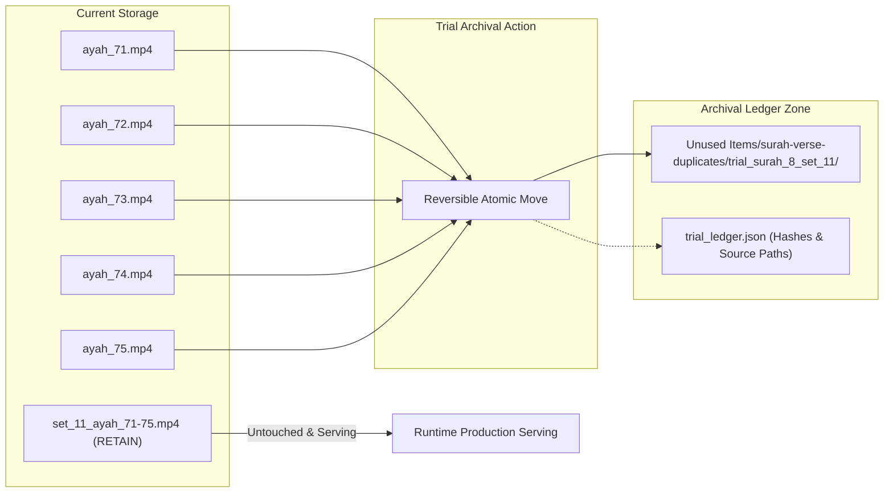

# HuDa Web Quran — Phase 5A: Controlled Migration Trial Plan

**Document Date:** October 22, 2026  
**Auditor & Planner:** Antigravity (Advanced Agentic AI Assistant)  
**Project Workspace:** `/Users/pearl-9744/Claude/Projects/huda-web-quran`  
**Execution Mode:** STRICT PLANNING ONLY (Zero file moves, zero renames, zero deletions, zero code edits)  
**Baseline Documents:** [`docs/PHASE4C_READ_ONLY_AUDIT_2026_10_22.md`](file:///Users/pearl-9744/Claude/Projects/huda-web-quran/docs/PHASE4C_READ_ONLY_AUDIT_2026_10_22.md) and [`docs/PHASE4D_MIGRATION_DECISION_REPORT_2026_10_22.md`](file:///Users/pearl-9744/Claude/Projects/huda-web-quran/docs/PHASE4D_MIGRATION_DECISION_REPORT_2026_10_22.md)  

---

## 1. Executive Summary & Trial Scope

This document details the operational plan for **Phase 5A**, establishing a small, isolated, and completely reversible controlled trial to validate our deduplication strategy and the approved **Hybrid URL Architecture**.

### Approved Direction Confirmed
1. **Hybrid URL Architecture:** Adopted as the primary structural design. Single background loops remain flat (`/videos/surah/<pad>-<slug>.mp4`), while multi-scene Surahs occupy canonical nested directories (`/videos/surah/<pad>-<slug>/<scene>.mp4`).
2. **Surah 3 Protection:** All 117 unique files (2.74 GB) in [`public/videos/surah_3/`](file:///Users/pearl-9744/Claude/Projects/huda-web-quran/public/videos/surah_3) are strictly protected and exempted from deduplication.
3. **Zero Bulk Migration:** Only a single, isolated candidate cluster will be processed once explicit approval is granted.
4. **Current State:** **PLANNING ONLY.** No files have been moved, renamed, deleted, or staged.

---

## 2. Step 1: Selected Candidate Cluster & Cryptographic Evidence

To validate deduplication safely without risking runtime regressions, we selected **Surah 8 (Al-Anfal), Set 11**.

### Why This Cluster Was Chosen
- **Complete Self-Containment:** Unlike clips reused across multiple Surahs, this video hash appears **exclusively within Surah 8**. It has zero cross-references to other Surahs or Inbox.
- **Small & Clean Footprint:** Contains exactly 1 source set file and 5 identical verse duplicate files (`ayah_71.mp4` through `ayah_75.mp4`).
- **Zero Runtime Dependencies:** Not referenced in [`src/lib/data/videoManifest.ts`](file:///Users/pearl-9744/Claude/Projects/huda-web-quran/src/lib/data/videoManifest.ts), [`src/lib/data/surahVerseVideos.ts`](file:///Users/pearl-9744/Claude/Projects/huda-web-quran/src/lib/data/surahVerseVideos.ts), or [`src/lib/data/surahChapters.ts`](file:///Users/pearl-9744/Claude/Projects/huda-web-quran/src/lib/data/surahChapters.ts).
- **Physical Independence:** All 5 duplicate files are genuine non-symlink binaries on disk (`islink = False`).

### Cryptographic Verification Table

| File Role | File Path | File Size (Bytes) | Size (MB) | SHA-256 Cryptographic Hash | Verification Parity |
|---|---|---:|---:|---|:---:|
| **Source Set (Retain)** | `public/videos/surah_8/set_11_ayah_71-75.mp4` | 22,895,642 | 21.83 MB | `cc67a93d89f4ea5b8c25dc3e9a5afebe7ccb10990a88515fcd37a4e75f00c21b` | **CANONICAL SOURCE** |
| Duplicate Ayah 71 | `public/videos/surah_8/ayah_71.mp4` | 22,895,642 | 21.83 MB | `cc67a93d89f4ea5b8c25dc3e9a5afebe7ccb10990a88515fcd37a4e75f00c21b` | **100% BYTE MATCH** |
| Duplicate Ayah 72 | `public/videos/surah_8/ayah_72.mp4` | 22,895,642 | 21.83 MB | `cc67a93d89f4ea5b8c25dc3e9a5afebe7ccb10990a88515fcd37a4e75f00c21b` | **100% BYTE MATCH** |
| Duplicate Ayah 73 | `public/videos/surah_8/ayah_73.mp4` | 22,895,642 | 21.83 MB | `cc67a93d89f4ea5b8c25dc3e9a5afebe7ccb10990a88515fcd37a4e75f00c21b` | **100% BYTE MATCH** |
| Duplicate Ayah 74 | `public/videos/surah_8/ayah_74.mp4` | 22,895,642 | 21.83 MB | `cc67a93d89f4ea5b8c25dc3e9a5afebe7ccb10990a88515fcd37a4e75f00c21b` | **100% BYTE MATCH** |
| Duplicate Ayah 75 | `public/videos/surah_8/ayah_75.mp4` | 22,895,642 | 21.83 MB | `cc67a93d89f4ea5b8c25dc3e9a5afebe7ccb10990a88515fcd37a4e75f00c21b` | **100% BYTE MATCH** |

```
Source File:      public/videos/surah_8/set_11_ayah_71-75.mp4 (21.83 MB)
Duplicate Copies: 5 files (109.18 MB total)
Net Redundancy:   109,178,210 bytes (109.18 MB reclaimable)
```

---

## 3. Step 2: Controlled Trial Execution Design

The trial will be executed only after user authorization. It guarantees zero risk through atomic logging and instant rollback capability.



### Proposed Trial Steps (When Authorized in Phase 5B)

1. **Target Directory Creation:**
   Create isolated staging directory:  
   `Unused Items/surah-verse-duplicates/trial_surah_8_set_11/`
2. **Move Execution with Ledger Generation:**
   Move the 5 duplicate files into the archive directory and generate `trial_ledger.json`.
3. **Post-Move Integrity Verification:**
   - Confirm `set_11_ayah_71-75.mp4` remains in `public/videos/surah_8/` with matching hash.
   - Confirm all 5 files exist in `Unused Items/` with identical SHA-256 hashes.
   - Run `npm run typecheck` to verify build integrity.
   - Verify that Next.js static asset serving functions without error.

### Structured Trial Ledger Schema

```json
{
  "trial_name": "phase5b_surah_8_set_11_trial",
  "executed_at": "2026-10-22T...",
  "canonical_parent": {
    "path": "public/videos/surah_8/set_11_ayah_71-75.mp4",
    "sha256": "cc67a93d89f4ea5b8c25dc3e9a5afebe7ccb10990a88515fcd37a4e75f00c21b",
    "file_size_bytes": 22895642,
    "status": "RETAINED_IN_PLACE"
  },
  "reclaimed_bytes": 114478210,
  "reclaimed_mb": 109.18,
  "entries": [
    {
      "original_path": "public/videos/surah_8/ayah_71.mp4",
      "archived_path": "Unused Items/surah-verse-duplicates/trial_surah_8_set_11/ayah_71.mp4",
      "sha256": "cc67a93d89f4ea5b8c25dc3e9a5afebe7ccb10990a88515fcd37a4e75f00c21b",
      "file_size_bytes": 22895642
    }
  ]
}
```

### Instant Rollback Commands & Verification

If any discrepancy or unexpected behavior occurs, execution of the following shell commands restores the original state in under 2 seconds:

```bash
# Rollback Command Suite
cp -p "Unused Items/surah-verse-duplicates/trial_surah_8_set_11/ayah_71.mp4" "public/videos/surah_8/ayah_71.mp4"
cp -p "Unused Items/surah-verse-duplicates/trial_surah_8_set_11/ayah_72.mp4" "public/videos/surah_8/ayah_72.mp4"
cp -p "Unused Items/surah-verse-duplicates/trial_surah_8_set_11/ayah_73.mp4" "public/videos/surah_8/ayah_73.mp4"
cp -p "Unused Items/surah-verse-duplicates/trial_surah_8_set_11/ayah_74.mp4" "public/videos/surah_8/ayah_74.mp4"
cp -p "Unused Items/surah-verse-duplicates/trial_surah_8_set_11/ayah_75.mp4" "public/videos/surah_8/ayah_75.mp4"

# Verification Command (Must output 5 passes)
python3 -c '
import hashlib
h_expected = "cc67a93d89f4ea5b8c25dc3e9a5afebe7ccb10990a88515fcd37a4e75f00c21b"
for i in range(71, 76):
    p = f"public/videos/surah_8/ayah_{i}.mp4"
    h = hashlib.sha256(open(p, "rb").read()).hexdigest()
    assert h == h_expected, f"Rollback mismatch on {p}"
print("ROLLBACK 100% VERIFIED: All 5 files restored with original byte hashes.")
'
```

---

## 4. Step 3: Hybrid URL Architecture Validation

The Hybrid Architecture balances zero production disruption with clean canonical organization.

### A. Flat URL Paradigm for Single-Loop Surahs (111 Surahs)
- **Path Pattern:** `/videos/surah/<pad>-<slug>.mp4` (e.g. `/videos/surah/104-al-humazah.mp4`).
- **Resolver Logic in [`src/lib/data/surahChapters.ts`](file:///Users/pearl-9744/Claude/Projects/huda-web-quran/src/lib/data/surahChapters.ts):**
  ```ts
  // Line 1033 dynamically constructs flat paths:
  const videoPath = `/videos/surah/${pad}-${slug}.mp4`;
  ```
- **Parity with Production:**
  - Cloudflare R2 contains objects at `videos/surah/<pad>-<slug>.mp4`.
  - Browser CDN requests resolve to `https://media.hudacdn.com/videos/surah/<pad>-<slug>.mp4`.
  - **Verdict:** Flat layout requires zero code changes, zero R2 re-uploads, and causes zero CDN cache misses.

### B. Nested Canonical Paradigm for Multi-Scene Surahs
- **Active Surahs:**
  - Surah 2: `/videos/surah/002-al-baqarah/01-the-book-of-guidance.mp4` (44 chapter files)
  - Surah 3: `/videos/surah/003-aal-e-imran/01a-the-immutable-foundation-and-muhkamat.mp4` (20 scene files)
  - Surah 18: `/videos/surah/018-al-kahf/01-cave-and-light.mp4` (3 scene files)
- **Verdict:** Multi-scene Surahs already exist as nested directories in production and in code.

### C. Complete Inventory of Patch 1 Paths Requiring Future Standardization (78 Paths)

The 78 paths added during Patch 1 currently use temporary non-padded directory names (`/videos/surah_19/...`). Under the Hybrid Architecture, they will transition to canonical zero-padded directories:

| Surah # | Surah Slug | Current Staged Path in Manifest | Target Canonical Hybrid Path | Set Count |
|:---:|---|---|---|:---:|
| 19 | Maryam | `/videos/surah_19/set_01_ayah_1-11.mp4` ... `set_14` | `/videos/surah/019-maryam/set_01_ayah_1-11.mp4` ... `set_14` | 14 sets |
| 23 | Al-Mu'minun | `/videos/surah_23/set_01_ayah_1-11.mp4` ... `set_14` | `/videos/surah/023-al-muminun/set_01_ayah_1-11.mp4` ... `set_14` | 14 sets |
| 25 | Al-Furqan | `/videos/surah_25/set_01_ayah_1-9.mp4` ... `set_08` | `/videos/surah/025-al-furqan/set_01_ayah_1-9.mp4` ... `set_08` | 8 sets |
| 26 | Ash-Shu'ara | `/videos/surah_26/set_01_ayah_1-9.mp4` ... `set_14` | `/videos/surah/026-ash-shuara/set_01_ayah_1-9.mp4` ... `set_14` | 14 sets |
| 28 | Al-Qasas | `/videos/surah_28/set_01_ayah_1-6.mp4` ... `set_11` | `/videos/surah/028-al-qasas/set_01_ayah_1-6.mp4` ... `set_11` | 11 sets |
| 30 | Ar-Rum | `/videos/surah_30/set_01_ayah_1-10.mp4` ... `set_08` | `/videos/surah/030-ar-rum/set_01_ayah_1-10.mp4` ... `set_08` | 8 sets |
| 31 | Luqman | `/videos/surah_31/set_01_ayah_1-11.mp4` ... `set_05` | `/videos/surah/031-luqman/set_01_ayah_1-11.mp4` ... `set_05` | 5 sets |
| 32 | As-Sajdah | `/videos/surah_32/set_01_ayah_1-9.mp4` ... `set_04` | `/videos/surah/032-as-sajdah/set_01_ayah_1-9.mp4` ... `set_04` | 4 sets |
| **TOTAL** | **8 Surahs** | — | — | **78 Sets** |

---

## 5. Verification Testing Protocols

Prior to any production cutover, the following 4-point verification battery must pass:

1. **Localhost Static Asset Serving Test:**
   - Verify HTTP 200 responses on `localhost:3000/videos/surah/set_11_ayah_71-75.mp4`.
   - Verify that absence of `ayah_71.mp4` creates **0 console errors** during audio/video playback.
2. **Production Media URL Resolver Test:**
   - Validate [`src/lib/media.ts`](file:///Users/pearl-9744/Claude/Projects/huda-web-quran/src/lib/media.ts) output when `NEXT_PUBLIC_MEDIA_BASE_URL` is populated vs empty.
3. **Manifest Whitelist Integrity Test:**
   - Verify `hasVideo(path)` in [`src/lib/data/videoManifest.ts`](file:///Users/pearl-9744/Claude/Projects/huda-web-quran/src/lib/data/videoManifest.ts) returns `true` for all canonical paths.
4. **Dual-Slot Crossfade Decoupling Test:**
   - Validate that [`src/components/home/SurahCinematicBackground.tsx`](file:///Users/pearl-9744/Claude/Projects/huda-web-quran/src/components/home/SurahCinematicBackground.tsx) seamlessly crossfades between Surah scenes without flashing black or dropping video slots.

---

## 6. Risk Analysis & Explicit Approval Checkpoints

| Checkpoint | Action | Risk Level | Required User Approval |
|---|---|:---:|:---:|
| **CP-1** | Create `Unused Items/.../trial_surah_8_set_11/` directory | NONE | **Required before Phase 5B** |
| **CP-2** | Move 5 duplicate files (`ayah_71..75.mp4`) into archive folder | LOW | **Required before Phase 5B** |
| **CP-3** | Verify runtime playback and build stability | LOW | Automated / Agent execution |
| **CP-4** | Rollback or promote based on trial findings | LOW | User review of Phase 5B report |

---

## 7. Status Sign-Off

- [x] Step 1 Complete: Candidate cluster selected (`surah_8`, set 11, 5 duplicate files).
- [x] Step 2 Complete: Reversible trial plan and rollback command suite defined.
- [x] Step 3 Complete: Hybrid URL Architecture validated and 78 Patch 1 paths mapped.
- [x] Step 4 Complete: Phase 5A report written.
- [x] Read-Only Integrity: Zero files moved, renamed, or modified.
- [x] Git Status: Clean and recorded.

**Status:** **PHASE 5A COMPLETE — STOPPED & AWAITING USER APPROVAL TO EXECUTE PHASE 5B TRIAL**
