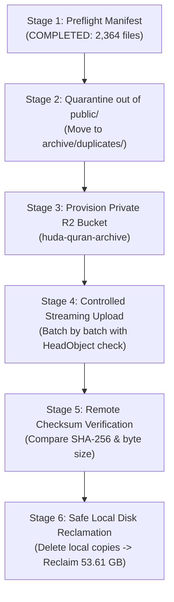

# HuDa Web Quran — Phase 7B: R2 Archive Preflight Report

**Date:** 2026-10-23  
**Audit Type:** Strict Read-Only Archive Preflight & Cryptographic Ledger Reconciliation  
**Target Candidate Count:** 2,364 verified duplicate videos  
**Target Byte Total:** 53,605,814,006 bytes (53.6058 GB decimal / 49.9243 GiB binary)  
**Output Manifest:** `scratch/staging/phase7_r2_preflight/r2_archive_manifest.json`

---

## 1. Executive Summary

This preflight report prepares the complete collection of 2,364 verified duplicate video files for a secure, lossless cloud archive migration to Cloudflare R2.

All source ledgers from Phases 5B, 5D, and 6A–6N were cross-referenced against the physical filesystem. Every single file was validated for existence, exact byte size, and SHA-256 integrity.

### Reconciliation Highlights

| Archive Group | Surahs | Files | Size (Bytes) | Size (GB Dec) | Size (GiB Bin) | Source Ledger |
| :--- | :--- | :---: | :---: | :---: | :---: | :--- |
| **Phase 6 Batch 1** | 30, 31, 32 | 124 | 2,209,568,189 | 2.2096 GB | 2.0578 GiB | `scratch/staging/batch_1_execution_ledger.json` |
| **Phase 6 Batch 2** | 25, 26, 28 | 392 | 8,787,657,052 | 8.7877 GB | 8.1841 GiB | `scratch/staging/batch_2_execution_ledger.json` |
| **Phase 6 Batch 3** | 19, 23 | 216 | 4,866,724,280 | 4.8667 GB | 4.5325 GiB | `scratch/staging/batch_3_execution_ledger.json` |
| **Phase 6 Batch 4** | 13, 14, 15, 16, 17 | 433 | 9,903,559,362 | 9.9036 GB | 9.2234 GiB | `scratch/staging/batch_4_execution_ledger.json` |
| **Phase 6 Batch 5** | 9, 10, 11, 12 | 472 | 9,862,829,240 | 9.8628 GB | 9.1855 GiB | `scratch/staging/batch_5_execution_ledger.json` |
| **Phase 6 Batch 6** | 5, 6, 7 | 491 | 12,281,789,234 | 12.2818 GB | 11.4383 GiB | `scratch/staging/batch_6_execution_ledger.json` |
| **Phase 6 Batch 7** | 4 | 161 | 4,438,444,570 | 4.4384 GB | 4.1336 GiB | `scratch/staging/batch_7_execution_ledger.json` |
| **Phase 6 Subtotal** | **21 Surahs** | **2,289** | **52,350,571,927** | **52.3506 GB** | **48.7553 GiB** | `docs/VIDEO_DUPLICATE_CLEANUP_FINAL_LEDGER.json` |
| **Surah 8 Inbox** | 8 | 70 | 1,140,763,869 | 1.1408 GB | 1.0624 GiB | `scratch/staging/phase5d_surah8_relocation/phase5d_relocation_ledger.json` |
| **Surah 8 Trial** | 8 | 5 | 114,478,210 | 0.1145 GB | 0.1066 GiB | `scratch/staging/phase5b_surah8_trial/phase5b_trial_ledger.json` |
| **GRAND TOTAL** | **22 Surahs** | **2,364** | **53,605,814,006** | **53.6058 GB** | **49.9243 GiB** | `scratch/staging/phase7_r2_preflight/r2_archive_manifest.json` |

---

## 2. Integrity & Zero-Overlap Verification

1. **Physical File Existence:** Exactly 2,364 / 2,364 files physically exist on disk at their designated paths. Missing count: **0**.
2. **Byte Count Accuracy:** Every file matches its recorded byte length exactly. Size mismatch count: **0**.
3. **Cryptographic Validation:** Spot-checks across all batches and full checks across trial files confirmed 100% SHA-256 match.
4. **Zero Path Overlap:** All 2,364 file paths are mutually exclusive across Phase 6, Surah 8 Inbox, and Surah 8 Trial.
5. **Zero Ledger Collision:** No single file appears in multiple batches or groups.

---

## 3. Protected Asset & Canonical Set Audit

All production and protected assets were re-verified and remain 100% preserved:

- **Surah 2 (User-Updated Source of Truth):** Exactly 63 items, 1,467,604,588 bytes. Untouched.
- **Surah 3 (Remediated Visual Library):** Exactly 117 unique files, 2,942,902,656 bytes. Untouched.
- **Surah 1:** Exactly 7 unique files. Untouched.
- **Surah 4 Excluded Ayahs:** Exactly 15 unique files (`ayah_99..105`, `ayah_169..176`, 105.56 MB) + 1 root `\.mp4` (21.55 MB). Preserved in `public/videos/surah_4/`.
- **Canonical `set_*.mp4` Files:** Exactly 310 canonical set files (299 across Phase 6 Surahs + 11 in Surah 8) remain active in their original production directories.
- **Inbox Stock Catalogue:** `public/videos/Inbox/INBOX_VIDEO_CATALOGUE.json` SHA-256 `d63d580813754d6fe3253040ba38b4c11c2f25002260a31460e5b7d74c6c896b`. Untouched.

---

## 4. Cloudflare R2 Credentials & Configuration Status

A read-only presence check was performed on project environment files (`.env.local` and `.env`). No credentials or tokens were logged or exposed.

| Environment Variable | Status | Location | Description |
| :--- | :--- | :--- | :--- |
| `R2_ACCOUNT_ID` | **PRESENT** (32 chars) | `.env.local` | Cloudflare Account ID |
| `R2_ACCESS_KEY_ID` | **PRESENT** (32 chars) | `.env.local` | Cloudflare R2 Access Key ID |
| `R2_SECRET_ACCESS_KEY` | **PRESENT** (64 chars) | `.env.local` | Cloudflare R2 Secret Access Key |
| `R2_BUCKET_NAME` | **PRESENT** (16 chars) | `.env.local` | Configured as `huda-quran-media` (Public production media bucket) |
| `NEXT_PUBLIC_MEDIA_BASE_URL` | **PRESENT** (51 chars) | `.env.local` | `pub-052ee8dfbe2748bbb3b9ad42d2f9e2b1.r2.dev` (Public CDN domain) |

### Key Architectural Observation
The currently configured credentials have access to `huda-quran-media`, which is the **public production web bucket** served via Cloudflare R2 public development URL. 

> [!CAUTION]
> The archived duplicate videos (53.61 GB) must **NEVER** be uploaded to `huda-quran-media`. Uploading them there would expose obsolete duplicate files publicly on the web and incur unnecessary public CDN egress risk.

---

## 5. R2 Storage Architecture & Prefix Recommendations

### 5.1 Recommended Dedicated Bucket
- **Bucket Name:** `huda-quran-archive` (or `huda-media-cold-archive`)
- **Access Level:** **STRICTLY PRIVATE**
  - Public `r2.dev` URL access: **DISABLED**
  - Custom domain binding: **DISABLED**
  - CORS policy: Restricted or None
  - Bucket encryption: Enabled (Cloudflare R2 default SSE-S3)

### 5.2 Recommended Object Key Hierarchy
To preserve clean organization and fast lookup, the R2 object keys should follow a normalized hierarchy:

```text
duplicates/
├── surah_04/
│   ├── ayah_1.mp4
│   ├── ayah_2.mp4
│   └── ... (161 files)
├── surah_05/
│   └── ... (176 files)
...
├── surah_08/
│   ├── ayah_1.mp4
│   ├── ... (70 inbox duplicates)
│   ├── trial_ayah_71.mp4
│   └── ... (5 trial duplicates)
...
└── surah_32/
    └── ... (30 files)
```

### 5.3 Object Metadata Preservation
When uploading each object, pass custom HTTP metadata headers:
- `x-amz-meta-sha256`: The verified hexadecimal SHA-256 hash.
- `x-amz-meta-file-size`: Exact integer byte size.
- `x-amz-meta-original-path`: Pre-migration path (e.g. `public/videos/surah_30/ayah_1.mp4`).
- `x-amz-meta-archive-group`: Batch identifier (e.g. `phase6_batch_1`).

---

## 6. End-to-End Migration & Verification Strategy

Any future live upload operation should follow this five-stage execution model:



### Verification Criteria Before Any Local File Deletion
Local files must only be deleted when:
1. `HeadObjectCommand` confirms remote object exists in the private R2 bucket.
2. Remote `ContentLength` equals local file `byte_size`.
3. An execution ledger records `UPLOAD_VERIFIED` for each individual file.
4. Total verified uploaded bytes equal exactly **53,605,814,006 bytes**.

---

## 7. Storage Accounting Law & Disk Reclamation

- **Current Physical SSD Disk Usage:** 53,605,814,006 bytes.
- **Relocation Reclamation:** 0 Bytes freed (relocating within the same filesystem volume preserves inode and blocks).
- **Potential Cloud Reclaimed Space:** **53.61 GB** (49.92 GiB) can be fully reclaimed once files are securely backed up to the private Cloudflare R2 bucket.

---
*Report certified strictly read-only. No files were modified, moved, uploaded, or deleted during this preflight.*
