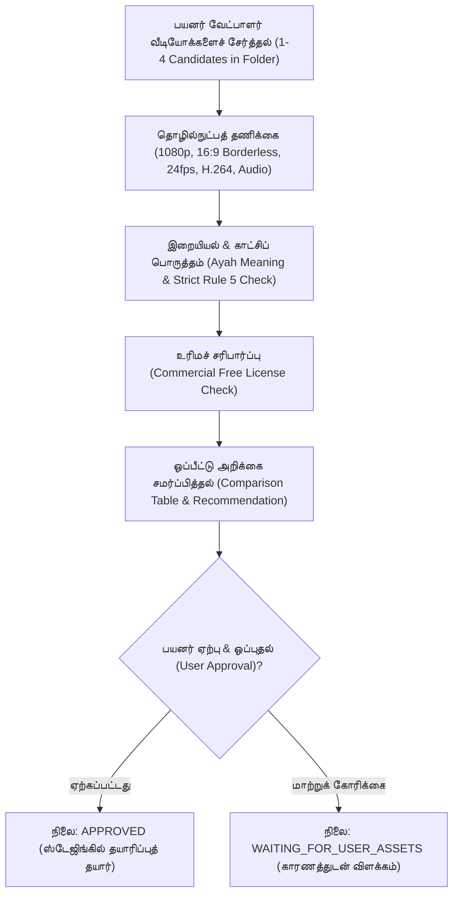
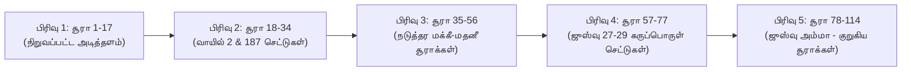

# 📖 HuDa Web Quran — குர்ஆன் காட்சித் தலைப்புகள் பட்டியல் (Surah-by-Surah Visual Topic Catalogue)

**திட்டம்:** HuDa Web Quran  
**முறைமை:** பயனர் வழிநடத்தும் நேரடித் தேர்வு முறை (User-Curated Visual Selection Workflow)  
**நிலை:** வாயில் 2-ன் 11 காட்சிகள் தயார் செய்யப்பட்டு, மீதமுள்ள சூராக்களுக்கான கட்டமைப்பு வகுக்கப்பட்டுள்ளது  
**அங்கீகார வாயில்கள்:** **Gate 2 & Gate 4 LOCKED** (அனுமதியின்றி தானியங்கி தயாரிப்பு மாற்றங்கள் முடக்கப்பட்டுள்ளன)  
**பட்ஜெட் இருப்பு:** ₹27,550.124 INR (₹0.00 செலவு, ₹600.00 கட்டாயத் தரை எல்லை பாதுகாக்கப்பட்டுள்ளது)

---

## 1. பணிப்பாய்வு தத்துவமும் வழிகாட்டுதல்களும் (Workflow Principles)

தானியங்கி API தலைமுறை அல்லது தானியங்கி தேடலிலிருந்து மாறி, **பயனரால் தேர்ந்தெடுக்கப்படும் உண்மையான வீடியோக்களை (User-Curated Real Stock Footage) மதிப்பாய்வு செய்து உறுதிப்படுத்தும் புதிய முறைமைக்கு** மாற்றப்பட்டுள்ளது:

1. **பூஜ்ஜிய கட்டண API செலவு (Zero Paid APIs):** எந்தவொரு கட்டண தலைமுறை சேவைகளோ (Google Veo போன்றவை) பயன்படுத்தப்பட மாட்டாது.
2. **உண்மையான லைவ்-ஆக்ஷன் வீடியோக்கள் மட்டுமே (Real Genuine Stock Only):** செயற்கையான ஏஐ அனிமேஷன்கள் (AI synthetic/Sora/Veo), போலி கணினி வரைகலை (CGI), நிலையான பட அசைவுகள் (Pan/Zoom static images) ஆகியவை முற்றிலும் தடைசெய்யப்பட்டுள்ளன.
3. **கண்டிப்பான இஸ்லாமிய இறையியல் விதி 5 (Strict Rule 5 Compliance):**
   * நபிமார்கள், அவர்களின் தோழர்கள் (ஸஹாபாக்கள்), வானவர்கள் (மலக்குகள்) ஆகியோரின் உருவங்களோ, முகங்களோ, உடல்களோ, நிழல்களோ (Silhouettes) எக்காரணம் கொண்டும் இடம்பெறக்கூடாது.
   * மனித வழிபாட்டுச் சின்னங்கள், பிற மதக் குறியீடுகள், ஆபாசங்கள், நவீன அநாகரிக அமைப்புகள் முற்றிலும் விலக்கப்பட வேண்டும்.
4. **தானியங்கி பதவி உயர்வு இன்மை (Zero Automatic Promotion):** பயனர் வழங்கும் வேட்பாளர் வீடியோக்கள் தணிக்கை செய்யப்பட்டு, மனித ஒப்புதல் பெறும் வரை தயாரிப்பு மேனிஃபெஸ்ட்டில் சேர்க்கப்பட மாட்டாது.

---

## 2. பிரிவு 1: வாயில் 2 — 11 அங்கீகரிக்கப்பட்ட குர்ஆனியக் காட்சிகள் (Gate 2 Catalogue)

குர்ஆன் வசனத் தரவுகள் (`public/data/quran-verses/*.json`) மற்றும் திட்டமிடல் முடிவுகளின் அடிப்படையில் துல்லியமாக வரையறுக்கப்பட்ட 11 காட்சிகள்:

| காட்சி # | சூரா & வசன எல்லை | காட்சித் தலைப்பு | காட்சி விளக்கம் (Description) | முக்கிய நிபந்தனைகள் (Constraints) | தேடல் சொற்கள் (Keywords) | வேட்பாளர் கோப்புறை (Folder) | தற்போதைய நிலை (Status) |
|---|---|---|---|---|---|---|---|
| **#1** | **சூரா 18** (அல்-கஹ்ஃப்) வசனங்கள் **89–98** (Set 15) | **துல்கர்னைனின் இரும்பு & செம்பு தடுப்புச்சுவர்** (Dhul-Qarnayn’s Barrier) | யஃஜூஜ்-மஃஜூஜ் கூட்டத்தாரிடமிருந்து மக்களைப் பாதுகாக்க இரு மலைகளுக்கு நடுவே (Bayn al-Saddayn) அமைக்கப்பட்ட பிரம்மாண்ட இரும்பு/செம்புத் தடுப்பு அல்லது இரு செங்குத்து மலைகளுக்கு இடையிலான கணவாய். | **இருக்க வேண்டியவை:** இரு செங்குத்தான இருண்ட பாறை மலைகள், ஆழமான கணவாய், தொன்மை வறண்ட பிரம்மாண்டம். **தவிர்க்கப்பட வேண்டியவை:** துல்கர்னைன், மனித உருவங்கள், யஃஜூஜ்-மஃஜூஜ் கற்பனை உருவங்கள், நவீன எஃகு/இயந்திரங்கள். | `towering dark mountain pass`, `steep rocky gorge aerial`, `ancient mountain canyon barren`, `canyon between two peaks` | [`user_candidates/gate2/scene_01_surah_18_ayah_89-98/`](file:///Users/pearl-9744/Claude/Projects/huda-web-quran/user_candidates/gate2/scene_01_surah_18_ayah_89-98/) | `REVIEWED` (Pixabay 70576 மாதிரி வீடியோ ஏற்கெனவே உள்ளது) |
| **#2** | **சூரா 20** (தாஹா) வசனங்கள் **9–16** (Set 2) | **சினாய் மலையடிவாரத்தில் இரவு நெருப்பு/ஒளி** (Distant Night Fire in Sinai) | மூஸா (அலை) அவர்கள் வாதி துவா புனிதப் பள்ளத்தாக்கில் கண்ட தூர் மலையடிவாரத்தின் தொலைதூர இரவு நெருப்பு/ஒளிச்சுடர். விண்மீன்கள் மின்னும் இருண்ட பாலைவன இரவில் மென்மையாக ஒளிரும் ஒளி. | **இருக்க வேண்டியவை:** விண்மீன்கள் நிறைந்த இரவு வானம், சினாய் பாறை மலைகள், தொலைவில் ஒளிரும் வெப்பமான இரவு நெருப்பு/ஒளி. **தவிர்க்கப்பட வேண்டியவை:** மூஸா (அலை), மனித முகங்கள்/உடல்கள்/நிழல்கள், சுற்றுலாப் பயணிகள், நவீன கூடாரங்கள், டார்ச் விளக்குகள், முகாம் உபகரணங்கள். | `distant campfire night mountain`, `fire on dark mountain night`, `night desert mountain single light`, `sinai mountain night stars fire` | [`user_candidates/gate2/scene_02_surah_20_ayah_09-16/`](file:///Users/pearl-9744/Claude/Projects/huda-web-quran/user_candidates/gate2/scene_02_surah_20_ayah_09-16/) | `WAITING_FOR_USER_ASSETS` (பயனர் வீடியோக்களுக்காகக் காத்திருக்கிறது) |
| **#3** | **சூரா 21** (அல்-அன்பியா) வசனங்கள் **87–88** (Set 13) | **யூனுஸ் நபியின் ஆழ்கடல் அடியாழ காரிருள்** (Deep Ocean Pelagic Void) | யூனுஸ் (அலை) அவர்கள் இறைவனை நோக்கிப் பிரார்த்தித்த ஆழ்கடலின் காரிருள் படுகுழி. மேற்பரப்பிலிருந்து மறையும் மெல்லிய ஒளிக் கதிர்கள் கரிய நீல இருளுக்குள் கரைந்துபோகும் ஆழ்ந்த அமைதியான பெருங்கடல் வெளி. | **இருக்க வேண்டியவை:** தூய ஆழ்கடல் நீர், ஆழம் செல்லச் செல்ல அடரும் காரிருள், மெல்லிய நீரோட்டம் மற்றும் இயற்கையான மிதவை நுண்துகள்கள். **தவிர்க்கப்பட வேண்டியவை:** திமிங்கல நிழல் (Whale silhouette - முடிவு 1-ன் படி தடை), யூனுஸ் (அலை), மனிதர்கள், ஸ்கூபா டைவர்கள், CGI துகள்கள். | `deep ocean abyss darkness`, `pelagic deep sea void`, `underwater darkness sunbeams fading`, `deep sea water darkness` | [`user_candidates/gate2/scene_03_surah_21_ayah_87-88/`](file:///Users/pearl-9744/Claude/Projects/huda-web-quran/user_candidates/gate2/scene_03_surah_21_ayah_87-88/) | `WAITING_FOR_USER_ASSETS` (பயனர் வீடியோக்களுக்காகக் காத்திருக்கிறது) |
| **#4** | **சூரா 22** (அல்-ஹஜ்) வசனங்கள் **26–33** (Set 5) | **வெறிச்சோடிய தொன்மை மலைக்கணவாய் ஹஜ் பாதை** (Empty Ancient Pilgrimage Mountain Pass) | தொலைதூர மலைக்கணவாய்களிலிருந்தும் (Fajj Amiq) மக்கள் இறையில்லத்தை நோக்கி வரும் பாதையைக் குறிக்கும் வெறிச்சோடிய செங்குத்துப் பாறை மலைப்பாதை. கரடுமுரடான மலைகளின் ஊடே அமைதியாக வளைந்து செல்லும் தொன்மையான ஒற்றையடிப் பாதை. | **இருக்க வேண்டியவை:** வெறிச்சோடிய சிவந்த/பழுப்பு பாறை மலைக்கணவாய், தொன்மைப் பாறைப் படிக்கட்டுகள்/பாதை, அதிகாலை சூரிய ஒளி. **தவிர்க்கப்பட வேண்டியவை:** மனிதர்கள், யாத்ரீகர்கள், ஒட்டக நிழல்கள் (Camel silhouettes - முடிவு 4-ன் படி தடை), நவீன தார்ச்சாலைகள், கார்கள், கடிகாரக் கோபுரம். | `ancient mountain pass empty trail`, `rocky canyon footpath desert`, `fajj amiq mountain pass`, `ancient stone steps mountain trail` | [`user_candidates/gate2/scene_04_surah_22_ayah_26-33/`](file:///Users/pearl-9744/Claude/Projects/huda-web-quran/user_candidates/gate2/scene_04_surah_22_ayah_26-33/) | `REVIEWED` (Pixabay 222163 மாதிரி வீடியோ ஏற்கெனவே உள்ளது) |
| **#5** | **சூரா 24** (அந்-நூர்) வசனம் **35** (Set 7) | **ஆயத்துன் நூர்: மாடக்குழியில் படிகக் கண்ணாடி விளக்கு** (Macro Glass Lamp in Stone Niche) | ஆயத்துன் நூர் உவமை: தொன்மையான கல்சுவர் மாடக்குழியில் (Mishkat) உள்ளே வைக்கப்பட்டுள்ள ஒளிவீசும் படிகக் கண்ணாடிப் பாத்திரத்தினுள் (Zujajah), பாக்கியம் பெற்ற ஒலிவ மரத்தின் தூய எண்ணெயினால் சுடர்விட்டு எரியும் தெளிவான அமைதியான தீபம். | **இருக்க வேண்டியவை:** கல் சுவர் மாடக்குழி (Stone alcove), தெளிவான கண்ணாடி/படிக விளக்கு, தூய மென்மையான ஒலிவ எண்ணெய் தீச்சுடர், அமைதியான பிரகாச ஒளி. **தவிர்க்கப்பட வேண்டியவை:** நவீன மெழுகுவர்த்தி, மின்சார பல்புகள், நவீன மண்ணெண்ணெய் விளக்கு, இந்து சமய மண் அகல் விளக்குகள், சர்ச் பலிபீடங்கள். | `antique glass oil lamp flame`, `ancient stone niche oil lamp`, `crystal lamp burning olive oil`, `macro glass oil lamp flame slow motion` | [`user_candidates/gate2/scene_05_surah_24_ayah_35/`](file:///Users/pearl-9744/Claude/Projects/huda-web-quran/user_candidates/gate2/scene_05_surah_24_ayah_35/) | `WAITING_FOR_USER_ASSETS` (பயனர் வீடியோக்களுக்காகக் காத்திருக்கிறது) |
| **#6** | **சூரா 24** (அந்-நூர்) வசனம் **39** (Set 8A) | **பாலைவன கானல் நீர் உவமை** (Parable of the Desert Mirage - Sarab) | நிராகரிப்பாளர்களின் செயல்களுக்கு உவமை: பரந்த வெப்பமான உவர்நில பாலைவனப் பரப்பில் (Qi'ah), தாகித்தவன் நீர் என நினைத்து ஏமாறும் வகையில் தரைமட்டத்தில் உக்கிர வெயிலால் அலை அலையாய் தோன்றும் ஒளியியல் கானல் நீர் (Sarab). | **இருக்க வேண்டியவை:** பரந்த வறண்ட பாலைவனப் பரப்பு/உவர்நிலம், தரைமட்ட வெப்ப அலைகள், அடிவானில் நீர் தளும்புவது போன்ற ஒளியியல் மாயத்தோற்றம். **தவிர்க்கப்பட வேண்டியவை:** நவீன தார்ச்சாலைகள், வாகனங்கள், காற்றாலைகள், மின் கம்பங்கள், சுற்றுலாப் பயணிகள், வாட்டர்மார்க்குகள். | `desert mirage heat shimmer`, `salt flat mirage heat haze`, `telephoto desert mirage water illusion`, `hot desert floor heat waves` | [`user_candidates/gate2/scene_06_surah_24_ayah_39/`](file:///Users/pearl-9744/Claude/Projects/huda-web-quran/user_candidates/gate2/scene_06_surah_24_ayah_39/) | `WAITING_FOR_USER_ASSETS` (பயனர் வீடியோக்களுக்காகக் காத்திருக்கிறது) |
| **#7** | **சூரா 24** (அந்-நூர்) வசனம் **40** (Set 8B) | **ஆழ்கடலில் அலைக்கு மேல் அலை மூடும் காரிருள் உவமை** (Layered Deep-Sea Darkness Under Waves) | நிராகரிப்பாளர்களின் நிலைக்கு மற்றொரு உவமை: பெருங்கடலின் (Bahr Lujjiy) ஆழத்தில் அலைக்கு மேல் அலை மூட, அதற்கு மேல் காரிருள் மேகங்கள் சூழ்ந்து கை நீட்டினால் கூட பார்க்க முடியாத அளவு மூடும் அடுக்குக் காரிருள். | **இருக்க வேண்டியவை:** கரிய பெருங்கடல் அலைகள், அலைக்கு மேல் எழும் பெரும் இயற்கை அலை அடுக்குகள், புயல் சூழ்ந்த அந்தி/இருள் வானம். **தவிர்க்கப்பட வேண்டியவை:** கப்பல்கள், படகுகள், கலங்கரை விளக்கம், மனித நீச்சல் வீரர்கள், பகல் நேர வெப்பமண்டல சுற்றுலா கடற்கரை. | `dark stormy ocean swell heavy waves`, `deep sea dark waves rolling`, `ocean storm waves twilight dark`, `bahr lujjiy deep sea waves` | [`user_candidates/gate2/scene_07_surah_24_ayah_40/`](file:///Users/pearl-9744/Claude/Projects/huda-web-quran/user_candidates/gate2/scene_07_surah_24_ayah_40/) | `REVIEWED` (Pixabay 283533 மாதிரி வீடியோ ஏற்கெனவே உள்ளது) |
| **#8** | **சூரா 27** (அந்-நம்ல்) வசனங்கள் **38–44** (Set 8) | **சுலைமான் நபியின் பளிங்கு தரை மீது ஓடும் நீர் மாளிகை** (Palace of Sulaiman: Crystal Floor Over Water) | சுலைமான் (அலை) அவர்களின் மாளிகையில் பல்கீஸ் அரசி நுழைந்தபோது ஆழமான நீர்நிலை என எண்ணிய, நீர் ஓடும் தளத்தின் மேல் பதிக்கப்பட்ட கண்ணாடித் தரை முற்றம் (Sarh Mumarrad min Qawarir). | **இருக்க வேண்டியவை:** தொன்மையான பிரம்மாண்ட அரண்மனை தூண்கள்/முற்றம், வெளிப்படையான மென்மையான கண்ணாடித் தரை, தளத்தின் கீழே அமைதியாக ஓடும் நீர். **தவிர்க்கப்பட வேண்டியவை:** சுலைமான் (அலை), பல்கீஸ் அரசி, ஊழியர்கள், நவீன நீச்சல் குளங்கள், நவீன பாத்ரூம் டைல்ஸ், ஹோட்டல் லாபி, நவீன கண்ணாடி வானளாவிய கட்டிடங்கள். | `glass floor over water ancient hall`, `palace courtyard water under glass floor`, `monumental colonnade reflective glass floor water` | [`user_candidates/gate2/scene_08_surah_27_ayah_38-44/`](file:///Users/pearl-9744/Claude/Projects/huda-web-quran/user_candidates/gate2/scene_08_surah_27_ayah_38-44/) | `WAITING_FOR_USER_ASSETS` (பயனர் வீடியோக்களுக்காகக் காத்திருக்கிறது) |
| **#9** | **சூரா 29** (அல்-அன்கபூத்) வசனங்கள் **41–44** (Set 5) | **சிலந்தியின் பலவீனமான வீடு உவமை** (Parable of the Spider Web - Strictly No Spider) | இணைவைப்பாளர்களின் பலவீனத்திற்கு உவமை: காற்றில் மிக மென்மையாக அசையும் சிலந்தியின் பலவீனமான வலை. காலைப் பனித்துளிகள் மின்னும் மெல்லிய நூல் இழைகள் (முடிவு 5-ன் படி சிலந்தி பூச்சி இன்றி). | **இருக்க வேண்டியவை:** மெல்லிய சிலந்தி வலை இழைகள், காலைப் பனித்துளிகள், காற்றில் மென்மையாக அசையும் இயக்கம், இயற்கை பின்னணி. **தவிர்க்கப்பட வேண்டியவை:** சிலந்தி பூச்சி (முடிவு 5-ன் படி கண்டிப்புடன் சிலந்தி நீக்கப்பட வேண்டும்), வலையில் சிக்கிய பூச்சிகள், செயற்கை ஹாலோவீன் வலைகள். | `spider web dew drops wind no spider`, `delicate gossamer spider web morning dew`, `macro spider web swaying gentle breeze` | [`user_candidates/gate2/scene_09_surah_29_ayah_41-44/`](file:///Users/pearl-9744/Claude/Projects/huda-web-quran/user_candidates/gate2/scene_09_surah_29_ayah_41-44/) | `REVIEWED` (Pixabay 28781 கிராப் செய்யப்பட்ட மாதிரி வீடியோ ஏற்கெனவே உள்ளது) |
| **#10** | **சூரா 33** (அல்-அஹ்ஸாப்) வசனங்கள் **9–20** (Set 2) | **அகழ் போர்க்களம்: உக்கிரமான பாலைவனப் புழுதிப் புயல் காற்று** (Battle of the Trench: Desert Gale & Duststorm) | அகழ் போரில் எதிரிப் படைகளை அப்புறப்படுத்த இறைவன் அனுப்பிய உக்கிரமான இரவுப் புயல் காற்று (Rihan wa Junudan). பாலைவன மணற்குன்றுகளில் புழுதியையும் மணலையும் சுழன்றடிக்கும் கடுமையான சூறாவளிக் காற்று. | **இருக்க வேண்டியவை:** பாலைவனப் புழுதிப் புயல், மணலை சுழன்றடிக்கும் தீவிர சூறாவளிக் காற்று, இருண்ட புயல் வளிமண்டலம், வறண்ட மணல் முகடுகள். **தவிர்க்கப்பட வேண்டியவை:** பனிப்புயல்/பனிமழை (முடிவு 6-ன் படி பனி நீக்கப்பட்டது), வீரர்கள், படைகள், ஆயுதங்கள், மனித காயங்கள், கூடாரங்கள், ஒட்டகங்கள். | `violent desert dust storm gale`, `night desert sandstorm wind howling`, `severe sandstorm blowing ridges`, `desert haboob dust storm dark` | [`user_candidates/gate2/scene_10_surah_33_ayah_09-20/`](file:///Users/pearl-9744/Claude/Projects/huda-web-quran/user_candidates/gate2/scene_10_surah_33_ayah_09-20/) | `REVIEWED` (Pixabay 372070 மாதிரி வீடியோ ஏற்கெனவே உள்ளது) |
| **#11** | **சூரா 34** (ஸபா) வசனங்கள் **15–17** (Set 3) | **ஸபா சமுதாயம்: பாறை மலைக்கணவாயில் சீறிப்பாயும் காட்டாற்று வெள்ளம்** (Flood of Saba: Marib Canyon Torrent) | நன்றி மறந்த ஸபா சமுதாயத்தின் மீது ஏவப்பட்ட அணையை உடைத்து சீறிப்பாய்ந்த காட்டாற்று வெள்ளம் (Sayl al-Arim). வறண்ட செங்குத்து பாறை மலைக் கணவாயில் நுரைத்துக்கொண்டு சீறிப்பாயும் உக்கிரமான வெள்ளப் பெருக்கு. | **இருக்க வேண்டியவை:** பாறை மலைக்கணவாயில் சீறிப்பாயும் உக்கிரமான வெள்ள நீர், வெள்ளை நுரை, வறண்ட பாறைப் பிளவுகள், பெரும் ஆற்றல். **தவிர்க்கப்பட வேண்டியவை:** மனிதர்கள் அடித்துச் செல்லப்படுவது, நவீன கான்கிரீட் அணைகள், நவீன கட்டிடங்கள் மூழ்குவது, கார்கள், நவீன பாலங்கள். | `flash flood roaring desert canyon`, `torrential rapids rocky gorge flood`, `surging brown flood waters mountain canyon` | [`user_candidates/gate2/scene_11_surah_34_ayah_15-17/`](file:///Users/pearl-9744/Claude/Projects/huda-web-quran/user_candidates/gate2/scene_11_surah_34_ayah_15-17/) | `REVIEWED` (Pixabay 47213 மாதிரி வீடியோ ஏற்கெனவே உள்ளது) |

---

## 3. பயனர் வேட்பாளர் சேர்க்கை மற்றும் ஆய்வு நெறிமுறை (Asset Intake & QA Workflow)

பயனர் ஒரு குறிப்பிட்ட காட்சிக்கு 1 முதல் 4 வீடியோக்களை வழங்கும் போது பின்பற்றப்படும் ஆய்வு நெறிமுறை:

### மதிப்பீட்டுத் தேவைகள்:
1. **தொழில்நுட்ப அளவீடுகள்:** 1920x1080 (Full HD), 16:9 விகிதம், பூஜ்ஜிய லெட்டர்பாக்ஸ் (கருப்புப் பட்டைகள் இன்மை), 24 fps, தெளிவான இயற்கை இயக்கம்.
2. **ஒப்பீட்டு அட்டவணை சமர்ப்பிப்பு:** பயனர் வீடியோக்களைச் சேர்த்தவுடன் ஏஜென்ட் உடனடியாக:
   * வேட்பாளர் கோப்புப் பெயர் (Candidate filename)
   * காட்சிப் பொருத்தம் (Visual match with Ayah context)
   * கவனிக்கப்பட வேண்டியவை / குறைபாடுகள் (Concerns / artifacts)
   * உரிம நிலை (License status)
   * திட்டவட்டமான பரிந்துரை (Recommendation: APPROVED அல்லது REJECTED with reason)
   ஆகியவற்றை சமர்ப்பிக்கும்.

---

## 4. குர்ஆனின் 114 சூராக்களுக்கும் விரிவுபடுத்தும் திட்டம் (Plan to Extend Across Surahs 1–114)

குர்ஆனின் அதிகாரப்பூர்வ வசனத் தரவுகளின்படி (`public/data/quran-verses/*.json`), அனைத்து 114 சூராக்களையும் 5 தனித்துவ நிலைகளாகப் பிரித்து காட்சிப் பட்டியல் விரிவுபடுத்தப்படும்:

### கட்டமைப்பு விவரங்கள்:
1. **பிரிவு 1 (சூராக்கள் 1–17):**
   * ஏற்கனவே [`src/lib/data/videoManifest.ts`](file:///Users/pearl-9744/Claude/Projects/huda-web-quran/src/lib/data/videoManifest.ts) மற்றும் [`scripts/pipeline/surah-meaning-overrides.mjs`](file:///Users/pearl-9744/Claude/Projects/huda-web-quran/scripts/pipeline/surah-meaning-overrides.mjs)-ல் நிறுவப்பட்ட தயாரிப்பு மாஸ்டர் செட்டுகள். இவற்றின் தலைப்புகளும் பயனர் பார்வைக்காக பட்டியலாக்கப்படும்.
2. **பிரிவு 2 (சூராக்கள் 18–34):**
   * [`docs/audit_17_pending_surahs.md`](file:///Users/pearl-9744/Claude/Projects/huda-web-quran/docs/audit_17_pending_surahs.md)-ல் தணிக்கை செய்யப்பட்ட 187 செட்டுகள்:
     * 173 நேரடி மறுபயன்பாட்டுச் செட்டுகள் (Direct Reuse Verified)
     * 3 உள்ளூர் கிராப் செட்டுகள் (Surah 19 & 20 Staged)
     * 11 புதிய காட்சிச் செட்டுகள் (Gate 2 Current Scope - மேலேயுள்ள அட்டவணை)
3. **பிரிவு 3 (சூராக்கள் 35–56):**
   * சூரா பாத்திர் முதல் அல்-வாகிஆ வரையிலான வசனங்களுக்கு 5 முதல் 10 வசனங்கள் கொண்ட கருப்பொருள் செட்டுகள் (Thematic sets 5–10 Ayahs) குர்ஆன் வசனப் பொருளின் அடிப்படையில் பட்டியலிடப்படும்.
4. **பிரிவு 4 (சூராக்கள் 57–77):**
   * சூரா அல்-ஹதீத் முதல் அல்-முர்ஸலாத் வரையிலான ஜுஸ்வு 27, 28, 29-ன் செட்டுகள்.
5. **பிரிவு 5 (சூராக்கள் 78–114 - ஜுஸ்வு அம்மா):**
   * மிகக் குறுகிய சூராக்கள் ஒவ்வொன்றிற்கும் 1 முதல் 3 கருப்பொருள் காட்சிகள் என்ற அடிப்படையில் துல்லியமான காட்சித் தலைப்புகள் உருவாக்கப்படும்.
