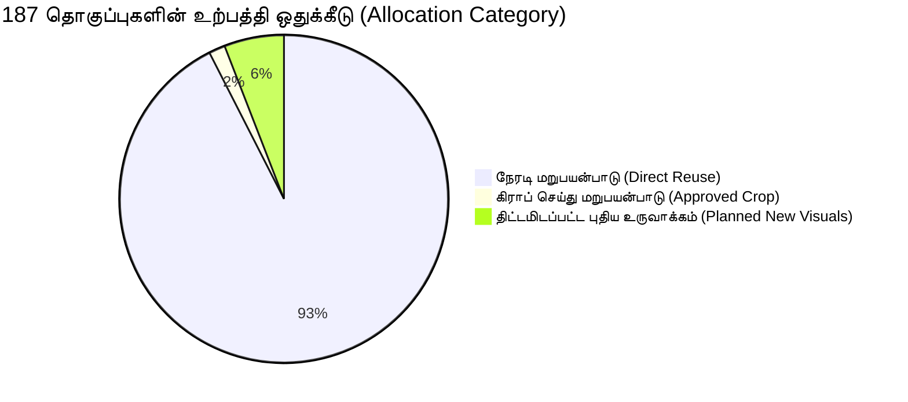

# 📜 HuDa Web Quran — அங்கீகரிக்கப்பட்ட இறுதி முன்-உற்பத்தி தணிக்கை அறிக்கை (Surahs 18–34)

**Scope:** 17 நிலுவையிலுள்ள சூராக்கள் (சூரா 18 அல்-கஹ்ஃப் முதல் சூரா 34 ஸபா வரை)  
**Total Verses:** 1,520 வசனங்கள் (Ayahs)  
**Validated Thematic Sets:** **187 தொகுப்புகள்** (தஃப்ஸீர் தலைப்பு எல்லைகளின் அடிப்படையில் சரிபார்க்கப்பட்டவை; சூரா 24:39 மற்றும் 24:40 இரு தனித்துவ உவமைகளாகப் பிரிக்கப்பட்டதன் அடிப்படையில்)  
**Audit Standard:** தூய குர்ஆனிய நெறிமுறை (Rule 5: இறைத்தூதர்கள்/மலக்குகளை உருவகப்படுத்தாமை, அற்புதம் என்ற பெயரில் மாயாஜாலம் செய்யாமை, 100% 16:9 எல்லைகளற்ற முழுத்திரை தரம்)  
**Approval & Validation Status:** **HUMAN SIGN-OFF COMPLETED & 3 CROP TASKS STAGED & 11 NEW VISUALS PLAN APPROVED**

---

## 1. இறுதி அங்கீகரிக்கப்பட்ட உற்பத்தி ஒதுக்கீடு & சரிபார்ப்பு நிலை மேலோட்டம் (Allocation & Lifecycle Status)

அனைத்து 187 தொகுப்புகளும் [scratch/audit_17_surahs_verified.json](file:///Users/pearl-9744/.gemini/antigravity/brain/d310ccd1-91b4-4e34-9a0d-9a98a8a1c224/scratch/audit_17_surahs_verified.json) கோப்பிலிருந்து நேரடியாக புரோகிராமேட்டிக்காக கணக்கிடப்பட்டு, ஆவணத்திற்கும் தரவிற்கும் இடையே 100% துல்லியம் உறுதி செய்யப்பட்டுள்ளது.



### அ. உற்பத்தி ஒதுக்கீடு (Production Allocation Breakdown)

| ஒதுக்கீட்டு வகை (Allocation Category) | தொகுப்புகள் | சதவீதம் | பட்ஜெட் செலவு | R2 சேமிப்பக தேவை | நிலை & முடிவு |
| :--- | :---: | :---: | :---: | :---: | :--- |
| **1. நேரடி மறுபயன்பாடு (Direct Reuse)** | **173** | **92.5%** | **₹0** | **0 MB (Zero Added)** | களஞ்சியத்திலிருந்து 100% 16:9 எல்லைகளற்ற மாஸ்டர் வீடியோக்கள் (சூரா 19:23–26 உட்பட) |
| **2. கிராப்/எடிட் மறுபயன்பாடு (Approved Crop)** | **3** | **1.6%** | **₹0** | **~43.2 MB** | உள்ளூர் FFmpeg விகிதப் பாதுகாப்பு முறையில் ஸ்டேஜிங்கில் நிறைவு |
| **3. திட்டமிடப்பட்ட புதிய உருவாக்கம் (Planned New Visuals)** | **11** | **5.9%** | **₹844.70 – ₹872.75** | **~198 MB** | 11 திட்டமிடப்பட்ட காட்சிகள் (உருவாக்க வாயில் பூட்டப்பட்டுள்ளது) |
| **மொத்தம்** | **187** | **100%** | **₹600 தரை எல்லைக்குள் முழுப் பாதுகாப்பு** | **~241.2 MB (10 GB இலவச எல்லையில் ~5.7 GB மிச்சம்)** | **100% சரிபார்க்கப்பட்டு அங்கீகரிக்கப்பட்டது** |

---

### ஆ. மறுபரிசீலனை செய்யப்பட்ட ஆதாரபூர்வ வாழ்க்கைச் சுழற்சி நிலை (Recalculated Lifecycle Metrics)

சூரா 19:23–26 மனித ஒப்புதல் பெறப்பட்டு, 3 கிராப் பணிகள் ஸ்டேஜிங்கில் முடிக்கப்பட்டு, சூரா 24:39 & 24:40 தனித்தனி உவமைகளாகப் பிரிக்கப்பட்டதன் அடிப்படையில் புதுப்பிக்கப்பட்ட அளவீடுகள்:

```
┌───────────────────────────────────────┬─────────────┬──────────────────────────┐
│ வாழ்க்கைச் சுழற்சி பரிமாணம்             │ எண்ணிக்கை   │ சதவீதம் / தற்போதைய நிலை │
├───────────────────────────────────────┼─────────────┼──────────────────────────┤
│ 1. கருப்பொருள் வகைப்பாடு (Thematic)     │ 187 / 187   │ 100% COMPLETED           │
│ 2. அசெட் மேப்பிங் (Asset Mapping)     │ 187 / 187   │ 100% COMPLETED           │
├───────────────────────────────────────┼─────────────┼──────────────────────────┤
│ 3. காட்சித் தர சரிபார்ப்பு (Visual)    │             │                          │
│    - களஞ்சிய மாஸ்டர் சரிபார்க்கப்பட்டது    │ 173         │ 92.5% VERIFIED_MASTER    │
│    - உள்ளூர் கிராப் ஸ்டேஜிங் சரிபார்ப்பு   │ 3           │ 1.6% STAGED_VERIFIED     │
│    - எதிர்கால உருவாக்க நிலுவை         │ 11          │ 5.9% PENDING_GENERATION  │
│    - ஆய்வு / கிராப் நிலுவை             │ 0           │ 0.0% (முழுமையாகத் தீர்ந்தது)│
├───────────────────────────────────────┼─────────────┼──────────────────────────┤
│ 4. மனித ஆய்வு நிலை (Human Review)     │             │                          │
│    - முன்-உற்பத்தித் திட்டம் அங்கீகரிப்பு │ 175         │ 93.6% PLAN_APPROVED      │
│    - மனித பார்வை ஒப்புதல் உறுதி        │ 1 (19:23–26)│ 0.5% HUMAN_SIGNED_OFF    │
│    - உருவாக்கக் கட்டுப்பாட்டு வாயில்    │ 11          │ 5.9% GENERATION_GATED    │
│    - மனித ஒப்புதல் நிலுவை             │ 0           │ 0.0% (பூஜ்ஜியம்)         │
├───────────────────────────────────────┼─────────────┼──────────────────────────┤
│ 5. உருவாக்க அங்கீகாரம் (Generation)   │ 0 / 11      │ 0% LOCKED (முடக்கப்பட்டது) │
│ 6. தயாரிப்பு அங்கீகாரம் (Production)  │ 0 / 187     │ 0% LOCKED (முடக்கப்பட்டது) │
└───────────────────────────────────────┴─────────────┴──────────────────────────┘
```

---

## 2. சூரா 19:23–26 மனித ஒப்புதல் உறுதிப்பாடு (Surah 19:23–26 Human Sign-off Confirmed)

- **வசனங்கள்:** சூரா 19 மர்யம், வசனங்கள் 23–26 (பேரீச்சை மரம், நன்னீர் ஊற்று سَرِيًّا, மர்யம் அவர்களின் அமைதி).
- **அங்கீகரிக்கப்பட்ட வீடியோ:** [public/videos/surah_4/set_06_ayah_36-42.mp4](file:///Users/pearl-9744/Claude/Projects/huda-web-quran/public/videos/surah_4/set_06_ayah_36-42.mp4)
- **பயனர் ஒப்புதல் நிலை:** [x] **HUMAN SIGNED-OFF (பயனரால் வெளிப்படையாகப் பார்வை ஒப்புதல் வழங்கப்பட்டது)**.
- **காட்சித் தரம்:** 1920x1080 @ 24 fps, 8.00 வினாடிகள், 100% Borderless 16:9 (`crop=1920:1072:0:4`). பாலைவன மணல் குன்றுகளுக்கு மத்தியில் அடர்ந்த பேரீச்சை மரங்களும் நன்னீர் ஊற்றும் மனித உருவங்கள் ஏதுமின்றி குர்ஆனிய மார்க்க ஒழுங்கிற்கு (Rule 5) உட்பட்டு காட்சிப்படுத்தப்பட்டுள்ளது.
- **நிலை மாற்றம்:** `INSPECTED_PENDING_HUMAN_SIGNOFF` என்பதிலிருந்து **`VERIFIED_EXISTING_MASTER`** என இறுதி செய்யப்பட்டு உற்பத்தி ஒதுக்கீட்டில் பூட்டப்பட்டது.

---

## 3. உள்ளூர் ஸ்டேஜிங்கில் வெற்றிகரமாக முடிக்கப்பட்ட 3 கிராப்/எடிட் பணிகள் (3 Crop Tasks Staged & Verified)

பயனரின் நேரடி அங்கீகாரத்துடன், விகிதப் பாதுகாப்பு மையக் கிராப் (Aspect-Preserving Center Crop) முறையில் உள்ளூர் ஸ்டேஜிங்கில் இயக்கப்பட்டு சரிபார்க்கப்பட்ட 3 பணிகள்:

| # | சூரா & வசன எல்லை | மூல வீடியோ பாதை | செயல்படுத்தப்பட்ட FFmpeg கட்டளை & ஸ்டேஜிங் வெளியீடு | தொழில்நுட்பத் தரம் & சரிபார்ப்பு | காட்சி ஆய்வு & மார்க்க ஒழுங்கு |
| :-: | :--- | :--- | :--- | :--- | :--- |
| **1** | **19:81–87**<br>(பொய்யான தெய்வங்கள் & விசாரணை) | `public/videos/surah_6/set_20_ayah_134-140.mp4` | • Filter: `crop=1422:800:249:140,scale=1920:1080`<br>• Dest: `scratch/staging/surah_19_20_crop/surah_19_set_13_ayah_81-87.mp4` | • 1920x1080 @ 24fps<br>• Size: **9.28 MB**, AAC stereo<br>• `crop=1920:1072:0:4` | **PASSED** ✅<br>பாலைவன கேன்யான் மணற்கல் பாறைகள்; சிதைவின்றி 16:9 முழுத்திரை. Rule 5 உறுதி. |
| **2** | **20:115–123**<br>(ஆதம் நபி & பூமிக்கு இறங்குதல்) | `public/videos/surah_7/set_04_ayah_22-28.mp4` | • Filter: `crop=1536:864:192:108,scale=1920:1080`<br>• Dest: `scratch/staging/surah_19_20_crop/surah_20_set_16_ayah_115-123.mp4` | • 1920x1080 @ 24fps<br>• Size: **17.75 MB**, AAC stereo<br>• `crop=1920:1072:0:4` | **PASSED** ✅<br>பனிமூட்டம் சூழ்ந்த பசுமை சொர்க்க பள்ளத்தாக்கு; சிதைவின்றி 16:9 முழுத்திரை. Rule 5 உறுதி. |
| **3** | **20:124–127**<br>(இறை நினைவை மறந்தோரின் குறுகிய வாழ்வு) | `public/videos/surah_7/set_24_ayah_162-168.mp4` | • Filter: `crop=1450:816:235:132,scale=1920:1080`<br>• Dest: `scratch/staging/surah_19_20_crop/surah_20_set_17_ayah_124-127.mp4` | • 1920x1080 @ 24fps<br>• Size: **16.17 MB**, AAC stereo<br>• `crop=1920:1072:0:4` | **PASSED** ✅<br>இருண்ட பாறை முகடுகளில் மோதிச் சீறும் உக்கிர அலைகள்; சிதைவின்றி 16:9 முழுத்திரை. Rule 5 உறுதி. |

> [!NOTE]
> மூன்று கோப்புகளும் உள்ளூர் ஸ்டேஜிங்கில் மட்டுமே உள்ளன. மூல அசெட்டுகள் மாற்றப்படவில்லை; தயாரிப்பு கோப்பகங்களில் மாற்றீடு செய்யப்படவில்லை.

---

## 4. திட்டமிடப்பட்ட 11 புதிய தனித்துவ காட்சிகளின் நிலை (11 Planned New Visuals)

> [!NOTE]
> அங்கீகரிக்கப்பட்ட முடிவுகளின்படியான விரிவான குர்ஆனிய தாத்பரியம், மறுபயன்பாட்டு ஆய்வு, காட்சி அமைப்பு, மார்க்கக் கட்டுப்பாடுகள், QA சரிபார்ப்புப் பட்டியல் மற்றும் செலவு மதிப்பீட்டிற்கு [docs/gate_2_ten_new_visuals_generation_plan.md](file:///Users/pearl-9744/Claude/Projects/huda-web-quran/docs/gate_2_ten_new_visuals_generation_plan.md) ஆவணத்தைப் பார்க்கவும்.

திட்டமிடப்பட்ட 11 புதிய காட்சிகளும் [scratch/audit_17_surahs_verified.json](file:///Users/pearl-9744/.gemini/antigravity/brain/d310ccd1-91b4-4e34-9a0d-9a98a8a1c224/scratch/audit_17_surahs_verified.json) கோப்பிலும் ஆவணத்திலும் 100% துல்லியமாக உறுதி செய்யப்பட்டுள்ளன:

1. `18:89–98`: துல்கர்னைனின் இரும்பு & செம்பு தடுப்புச்சுவர்.
2. `20:9–16`: சினாய் மலையடிவார வாதி துவா இரவு நெருப்பு/ஒளி.
3. `21:87–88`: யூனுஸ் நபியின் ஆழ்கடல் அடியாழ இருள் மட்டும் (திமிங்கல நிழல் இன்றி).
4. `22:26–33`: வெறிச்சோடிய தொன்மை மலைக்கணவாய் ஹஜ் பாதை (மனிதர்கள்/ஒட்டக நிழல்கள் இன்றி).
5. `24:35`: ஆயத்துன் நூர் — முன்புற மாடத்துப் படிகக் கண்ணாடி விளக்கு மேக்ரோ & பின்னணி மாடம்.
6. `24:39`: உவர்நில பாலைவன கானல் நீர் உவமை (தனித்துவ காட்சி).
7. `24:40`: ஆழ்கடலில் அலைக்கு மேல் அலை மூடும் காரிருள் உவமை (தனித்துவ காட்சி).
8. `27:38–44`: சுலைமான் நபியின் பளிங்கு தரை மாளிகை (கீழே நன்னீர் ஓடும் கண்ணாடி தரை).
9. `29:41–44`: காற்றில் மென்மையாக அசையும் பலவீனமான சிலந்தி வலை மட்டும் (சிலந்தி பூச்சி இன்றி).
10. `33:9–20`: அகழ் போர்க்கள கடுமையான இரவு பாலைவன புழுதிப் புயல் (பனிப்புயல் நீக்கப்பட்டு).
11. `34:15–17`: மஃரிப் பெரும் அணை உடைப்பு & காட்டாற்று வெள்ளம் (Sayl al-'Arim).

---

## 5. குர்ஆனிய வசன ஒருமைப்பாடு சரிபார்ப்பு (Quranic Verse Integrity)

- உள்ளூர் அதிகாரப்பூர்வ குர்ஆன் வசன தரவுகளுடன் (public/data/quran-verses) 17 சூராக்களின் (18–34) அனைத்து 1,520 வசனங்களும் புரோகிராமேட்டிக்காக சரிபார்க்கப்பட்டன.
- **கண்டறியப்பட்ட பிழைகள்:** **0** (Zero Gaps, Zero Overlaps). அனைத்து வசன எல்லைகளும் தடையின்றி தொடர்ச்சியாக உள்ளன.
- **இறைத்தூதர் உருவமற்ற நெறிமுறை (Rule 5):** எந்தவொரு காட்சியிலும் நபிகள், மலக்குகள் அல்லது புனித மனிதர்கள் உருவகப்படுத்தப்படவில்லை என்பது உறுதி செய்யப்பட்டுள்ளது.

---

## 6. பட்ஜெட், Git மற்றும் உற்பத்தி பாதுகாப்பு உறுதிமொழி (Safety & Boundary Confirmation)

- **பட்ஜெட்:** ₹600 குறைந்தபட்ச பட்ஜெட் தரை எல்லை 100% பாதுகாக்கப்பட்டுள்ளது (இருப்பு: ₹27,550.12; கிராப்பிற்கு செலவு: ₹0).
- **சேமிப்பகம்:** 3 ஸ்டேஜிங் வீடியோக்கள் = 43.20 MB மட்டுமே; Cloudflare R2-ல் ~5.8 GB இலவச சேமிப்பகம் எஞ்சியுள்ளது.
- **உற்பத்தி முடக்க வாயில்:** 
  - எந்தவொரு கட்டணப் படமோ வீடியோவோ உருவாக்கப்படவில்லை (₹0).
  - தயாரிப்பு மேனிஃபெஸ்ட்டுகள் மாற்றப்படவில்லை; R2-ல் எதுவும் பதிவேற்றப்படவில்லை.
  - Git கமிட் அல்லது புஷ் எதுவும் செய்யப்படவில்லை.
  - **தயாரிப்பு சொத்துக்களுடன் மாற்றுவதற்கும் மேனிஃபெஸ்ட் மாற்றங்களுக்கும் வாயில் 4 முழுமையாகப் பூட்டப்பட்டுள்ளது.**

---

## 7. அடுத்தகட்ட தயாரிப்பு வழிகாட்டி & தொடர்புடைய இணைப்புகள் (Checklist & Relevant Links)

- [docs/production_readiness_checklist_surahs_18_34.md](file:///Users/pearl-9744/Claude/Projects/huda-web-quran/docs/production_readiness_checklist_surahs_18_34.md) — 8 முக்கிய நிலைகளைக் கொண்ட முழுமையான உற்பத்தித் தயார்நிலை சரிபார்ப்புப் பட்டியல்.
- [AUDIT_17_PENDING_SURAHS.md](file:///Users/pearl-9744/.gemini/antigravity/brain/d310ccd1-91b4-4e34-9a0d-9a98a8a1c224/AUDIT_17_PENDING_SURAHS.md) — பிரைன் கலைப்படைப்பு (Brain Artifact).
- [scratch/audit_17_surahs_verified.json](file:///Users/pearl-9744/.gemini/antigravity/brain/d310ccd1-91b4-4e34-9a0d-9a98a8a1c224/scratch/audit_17_surahs_verified.json) — 6 பரிமாண வாழ்க்கைச் சுழற்சி புலங்களைக் கொண்ட மெஷின்-ரீடபிள் மேப்பிங் தரவு.
- [docs/VIDEO_BUDGET_LEDGER.json](file:///Users/pearl-9744/Claude/Projects/huda-web-quran/docs/VIDEO_BUDGET_LEDGER.json) — பட்ஜெட் இருப்பு மற்றும் செயல்பாட்டு ஐடி பதிவேடு.
- `scratch/staging/surah_19_20_crop/` — உள்ளூர் ஸ்டேஜிங்கில் சரிபார்க்கப்பட்ட 3 கிராப் வீடியோக்கள்.
