# 📋 HuDa Web Quran — வாயில் 2: 11 புதிய காட்சிகளுக்கான தலைமுறைத் திட்டம் (Gate 2: Eleven New Visuals Generation Plan)

**திட்டம்:** HuDa Web Quran — 17 நிலுவையிலுள்ள சூராக்கள் (சூரா 18 முதல் 34 வரை)  
**நிலை:** **அங்கீகரிக்கப்பட்ட முடிவுகளுடன் கூடிய திட்டமிடல் மற்றும் சரிபார்ப்பு மட்டுமே (PLANNING & VALIDATION ONLY)**  
**அங்கீகார வாயில் (Gate 2):** **முடக்கப்பட்டுள்ளது (LOCKED)** — பயனரின் தனித்தனி நேரடி உத்தரவின்றி எந்தவொரு கட்டண ஏபிஐ தலைமுறையும் தொடங்கப்படாது.  
**தயாரிப்பு வாயில் (Gate 4):** **முடக்கப்பட்டுள்ளது (LOCKED)** — தயாரிப்பு மேனிஃபெஸ்ட், R2 பதிவேற்றம், மற்றும் அசெட் மாற்றீடு நிறுத்தி வைக்கப்பட்டுள்ளன.  
**பட்ஜெட் தரை எல்லை (Budget Floor):** ₹600.00 (கட்டாய தரை எல்லை; தற்போதைய இருப்பு: ₹27,550.12).  

---

## 1. 11 புதிய காட்சிகளின் குர்ஆனிய எல்லை மற்றும் தேவை சரிபார்ப்பு (Requirement Verification)

பயனரால் அங்கீகரிக்கப்பட்ட முடிவுகளின்படி (User Approved Decisions), சூரா 24:39–40 வசனங்களிலுள்ள இரு தனித்துவ உவமைகளும் தனித்தனி காட்சிகளாகப் பிரிக்கப்பட்டு, திட்டமிடப்பட்ட புதிய காட்சிகளின் எண்ணிக்கை 10-லிருந்து **11 காட்சிகளாக** உயர்த்தப்பட்டுள்ளது.

அனைத்து 11 காட்சிகளும் [scratch/audit_17_surahs_verified.json](file:///Users/pearl-9744/.gemini/antigravity/brain/d310ccd1-91b4-4e34-9a0d-9a98a8a1c224/scratch/audit_17_surahs_verified.json) கோப்பிலும், உள்ளூர் குர்ஆன் வசன தரவுகளிலும் (`public/data/quran-verses/*.json`), மற்றும் தணிக்கை ஆவணங்களிலும் 100% துல்லியமாகச் சரிபார்க்கப்பட்டுள்ளன:

```mermaid
flowchart TD
    G2["Gate 2: 11 New Visuals Plan (₹844.70 - ₹872.75)"]
    G2 --> V1["1. Surah 18:89–98: இரும்பு & செம்பு தடுப்புச்சுவர்"]
    G2 --> V2["2. Surah 20:9–16: சினாய் மலையடிவார இரவு நெருப்பு"]
    G2 --> V3["3. Surah 21:87–88: யூனுஸ் நபியின் ஆழ்கடல் அடியாழ இருள் மட்டும்"]
    G2 --> V4["4. Surah 22:26–33: வெறிச்சோடிய தொன்மை மலைக்கணவாய் ஹஜ் பாதை"]
    G2 --> V5["5. Surah 24:35: ஆயத்துன் நூர் படிகக் கண்ணாடி விளக்கு மேக்ரோ"]
    G2 --> V6["6. Surah 24:39: உவர்நில பாலைவன கானல் நீர் உவமை"]
    G2 --> V7["7. Surah 24:40: அலைக்கு மேல் அலை மூடும் ஆழ்கடல் காரிருள்"]
    G2 --> V8["8. Surah 27:38–44: சுலைமான் நபியின் பளிங்கு தரை மாளிகை"]
    G2 --> V9["9. Surah 29:41–44: காற்றில் அசையும் பலவீனமான சிலந்தி வலை மட்டும்"]
    G2 --> V10["10. Surah 33:9–20: அகழ் போர்க்கள இரவு பாலைவன புழுதிப் புயல்"]
    G2 --> V11["11. Surah 34:15–17: மஃரிப் அணை உடைப்பு & காட்டாற்று வெள்ளம்"]
```

---

## 2. மறுபயன்பாட்டு ஆய்வு மற்றும் அங்கீகரிக்கப்பட்ட 11 தலைமுறைத் திட்டங்கள் (Detailed Generation & Reuse Plan)

### காட்சி 1: சூரா 18:89–98 — துல்கர்னைனின் இரும்பு & செம்பு தடுப்புச்சுவர் (Dhul-Qarnayn’s Barrier)
- **சூரா & வசன எல்லை:** சூரா 18 அல்-கஹ்ஃப், வசனங்கள் 89–98 (Set 15).
- **குர்ஆனிய நோக்கம்:** யஃஜூஜ்-மஃஜூஜ் கூட்டத்தாரிடமிருந்து மக்களைப் பாதுகாக்க துல்கர்னைன் இரு மலைகளுக்கு இடையே (بَيْنَ السَّدَّيْنِ) இரும்புப் பாளங்களை அடுக்கி (زُبَرَ الْحَدِيدِ), அதன் மீது உருகிய செம்பை ஊற்றி (أُفْرِغْ عَلَيْهِ قِطْرًا) அமைத்த துளைக்க முடியாத பிரம்மாண்ட தடுப்புச்சுவர்.
- **மறுபயன்பாட்டு ஆய்வு (Reuse Feasibility):** **மறுபயன்பாடு சாத்தியமில்லை (NO MATCH)**. நூலகத்தில் இயற்கை மலைகளும் மணற்குன்றுகளும் மட்டுமே உள்ளன. உருகிய செம்பும் இரும்பு பாளங்களும் இணைந்த தொன்மை உலோகப் பொறியியல் அமைப்பு எதிலும் இல்லை.
- **காட்சி அமைப்பு (Composition):** இரு பெரும் செங்குத்துப் பாறை மலைகளுக்கு நடுவே உள்ள கணவாயை முற்றிலும் அடைக்கும் பிரம்மாண்டமான தடுப்புச்சுவர்; செவ்வக இரும்பு பாளங்களின் இணைப்புகளில் உருகிய செம்பு வழிந்து கெட்டிப்பட்ட செம்பழுப்பு-தங்க நிற பளபளப்பு; வான்வழி சினிமா பகல் காட்சி; வளிமண்டல லேசான புழுதி.
- **தடைசெய்யப்பட்டவை (Rule 5):** மனித உருவங்கள் (துல்கர்னைன், தொழிலாளர்கள்) காட்டப்படக்கூடாது; யஃஜூஜ்-மஃஜூஜ் கற்பனை உருவங்கள் கூடாது; மாயாஜால மந்திர ஒளிகள் கூடாது; நவீன எஃகு அல்லது இயந்திரங்கள் கூடாது.
- **தொழில்நுட்ப விவரக்குறிப்புகள்:** 1920x1080 (16:9), 24 fps, 8.00 வினாடிகள், H.264 (CRF 21, slow), AAC Stereo 48kHz, லெட்டர்பாக்ஸ் $0\text{px}$.
- **QA ஏற்பு சரிபார்ப்புப் பட்டியல்:**
  - [ ] இரு மலை முகடுகளுக்கு இடையிலான கணவாயை அடைக்கும் தடுப்புச்சுவர்.
  - [ ] இரும்பு மற்றும் செம்புப் பூச்சின் கம்பீரமான தொன்மை அமைப்பு.
  - [ ] மனிதர்களோ, முகங்களோ, நிழல்களோ இல்லாமை.
  - [ ] எல்லைகளற்ற 100% 16:9 முழுத்திரை தரம்.
- **மதிப்பிடப்பட்ட செலவு (Ledger Evidence):** Veo 3.1: **₹76.791** + ஸ்டில் முன்னோட்டம்: **₹2.55** = **₹79.341**.
- **அங்கீகரிக்கப்பட்ட முடிவு:** பயனரால் உறுதிசெய்யப்பட்ட காட்சி தேவை.

---

### காட்சி 2: சூரா 20:9–16 — சினாய் மலையடிவார வாதி துவா இரவு நெருப்பு (Distant Night Fire in Sinai)
- **சூரா & வசன எல்லை:** சூரா 20 தாஹா, வசனங்கள் 9–16 (Set 2).
- **குர்ஆனிய நோக்கம்:** மூஸா நபி குளிர்கால இரவில் சினாய் பாலைவனத்தில் பயணம் செய்தபோது, தூர் மலையடிவாரத்தில் தொலைவில் ஒரு நெருப்பைக் கண்டு (إِذْ رَأَىٰ نَارًا), குடும்பத்தாரிடம் வழிகாட்டுதல் அல்லது கனல் கொண்டுவரச் சென்று, வாதி துவா புனிதப் பள்ளத்தாக்கில் (بِالْوَادِ الْمُقَدَّسِ طُوًى) இறைவனால் அழைக்கப்பட்ட நிகழ்வு.
- **மறுபயன்பாட்டு ஆய்வு (Reuse Feasibility):** **மறுபயன்பாடு சாத்தியமில்லை (NO MATCH)**. முந்தைய வேட்பாளர் பகல் நேர மலை; இரவுக் குளிரும் தூரத்து நெருப்பு/ஒளியும் அத்தியாவசியம் என்பதால் மறுபயன்பாடு நிராகரிக்கப்பட்டது.
- **காட்சி அமைப்பு (Composition):** விண்மீன்கள் மின்னும் இருண்ட பாலைவன இரவில் சினாய் மலைத்தொடரின் அமைதியான பரந்த காட்சி; தொலைதூர பாறை சரிவில் மென்மையாக ஒளிரும் ஒரு கதகதப்பான நெருப்பு/ஒளிச்சுடர்; அமைதியான பாலைவனக் காற்று; இறையச்ச சூழல்.
- **தடைசெய்யப்பட்டவை (Rule 5):** மூஸா நபியோ, மனித உருவங்களோ, குடும்பத்தாரின் நிழல்களோ காட்டப்படக்கூடாது; தெய்வ உருவங்கள் கூடாது; கார்ட்டூன் போன்ற பச்சை நிற மாயாஜால நெருப்பு கூடாது.
- **தொழில்நுட்ப விவரக்குறிப்புகள்:** 1920x1080 (16:9), 24 fps, 8.00 வினாடிகள், H.264, AAC Stereo, லெட்டர்பாக்ஸ் $0\text{px}$.
- **QA ஏற்பு சரிபார்ப்புப் பட்டியல்:**
  - [ ] விண்மீன்கள் நிறைந்த இரவு வானமும் சினாய் பாறை மலைகளும்.
  - [ ] தொலைவில் மலையடிவாரத்தில் தெளிவாக ஒளிரும் வெப்பமான நெருப்பு/ஒளி.
  - [ ] பூஜ்ஜிய மனித உருவங்கள் / நிழல்கள்.
  - [ ] எல்லைகளற்ற 100% 16:9 முழுத்திரை தரம்.
- **மதிப்பிடப்பட்ட செலவு (Ledger Evidence):** Veo 3.1: **₹76.791** + ஸ்டில்: **₹2.55** = **₹79.341**.
- **அங்கீகரிக்கப்பட்ட முடிவு:** பயனரால் உறுதிசெய்யப்பட்ட காட்சி தேவை.

---

### காட்சி 3: சூரா 21:87–88 — யூனுஸ் நபியின் ஆழ்கடல் அடியாழ இருள் மட்டும் (Deep Ocean Abyss Only)
- **சூரா & வசன எல்லை:** சூரா 21 அல்-அன்பியா, வசனங்கள் 87–88 (Set 13).
- **குர்ஆனிய நோக்கம்:** பெருமீனின் வயிற்றில் இருந்த யூனுஸ் நபி (துன்னூன்) ஆழ்கடலின் முப்பெரும் இருள்களிலிருந்து இறைவனை நோக்கிப் பிரார்த்தித்த நிகழ்வு (فَنَادَىٰ فِي الظُّلُمَاتِ أَن لَّا إِلَٰهَ إِلَّا أَنتَ سُبْحَانَكَ).
- **மறுபயன்பாட்டு ஆய்வு (Reuse Feasibility):** **மறுபயன்பாடு சாத்தியமில்லை (NO MATCH)**. நூலகத்திலுள்ள கடல் காட்சிகள் அனைத்தும் சூரிய ஒளி பாயும் மேற்பரப்பு அலைகள் மட்டுமே; ஒளி புகமுடியாத பெருங்கடலின் அடியாழ படுகுழி எதிலும் இல்லை.
- **அங்கீகரிக்கப்பட்ட காட்சி அமைப்பு (Approved Decision 1):** **தூய ஆழ்கடல் அடியாழ இருண்ட நீர் மட்டுமே (Deep Ocean Abyss Only)**. மேலே இருந்து மிக மங்கலாகக் கசியும் ஒளிக்கதிர்கள் அடியாழ இருளுக்குள் மறைந்துபோதல்; நீரில் மிதக்கும் நுண்ணிய துகள்கள்; பிரம்மாண்டமான அமைதியான ஆழம்.
- **தடைசெய்யப்பட்டவை (Rule 5):** **திமிங்கல நிழல் (Whale Silhouette) சேர்க்கப்படக்கூடாது**; யூனுஸ் நபியோ, மனித உருவங்களோ, மீனின் வயிற்றுக்குள் மனிதர் அமர்ந்திருக்கும் காட்சியோ எக்காரணம் கொண்டும் காட்டப்படக்கூடாது.
- **தொழில்நுட்ப விவரக்குறிப்புகள்:** 1920x1080 (16:9), 24 fps, 8.00 வினாடிகள், H.264, AAC Stereo, லெட்டர்பாக்ஸ் $0\text{px}$.
- **QA ஏற்பு சரிபார்ப்புப் பட்டியல்:**
  - [ ] உண்மையான ஆழ்கடல் அடியாழ இருள் (Pelagic abyss).
  - [ ] ஆழத்தை உணர்த்தும் மென்மையான நீரோட்டம் மற்றும் மிதவை நுண்துகள்கள்.
  - [ ] திமிங்கல நிழலோ, மனித உருவங்களோ இல்லாமை (Strict Rule 5).
  - [ ] எல்லைகளற்ற 100% 16:9 முழுத்திரை தரம்.
- **மதிப்பிடப்பட்ட செலவு (Ledger Evidence):** Veo 3.1: **₹76.791** + ஸ்டில்: **₹2.55** = **₹79.341**.
- **அங்கீகரிக்கப்பட்ட முடிவு:** திமிங்கல நிழலற்ற தூய ஆழ்கடல் அடியாழ இருள் உறுதி செய்யப்பட்டது.

---

### காட்சி 4: சூரா 22:26–33 — வெறிச்சோடிய தொன்மை மலைக்கணவாய் ஹஜ் பாதை (Empty Pilgrimage Mountain Pass)
- **சூரா & வசன எல்லை:** சூரா 22 அல்-ஹஜ், வசனங்கள் 26–33 (Set 5).
- **குர்ஆனிய நோக்கம்:** இப்ராஹீம் நபிக்கு கஃபாவின் தளத்தை அமைத்துக்கொடுத்து, மனிதர்களுக்கு ஹஜ் அழைப்பு விடுக்கக் கட்டளையிடப்பட்ட நிகழ்வு: "அவர்கள் நடந்தும், தொலைதூர மலைக்கணவாய்களிலிருந்தும் (مِن كُلِّ فَجٍّ عَمِيقٍ) மெலிந்த ஒட்டகங்கள் மீதும் உம்மிடம் வருவார்கள்".
- **மறுபயன்பாட்டு ஆய்வு (Reuse Feasibility):** **மறுபயன்பாடு சாத்தியமில்லை (NO MATCH)**. தற்போதுள்ள வீடியோக்கள் காற்று வீசும் மணற்குன்றுகள் மட்டுமே; மக்காவின் செங்குத்தான தொன்மை மலைக்கணவாய்களை (Fajj 'Amiq) கொண்டிருக்கவில்லை.
- **அங்கீகரிக்கப்பட்ட காட்சி அமைப்பு (Approved Decision 4):** **வெறிச்சோடிய தொன்மையான பாறை மலைக்கணவாய்ப் பாதை மட்டுமே (Empty Ancient Rocky Pilgrimage Pass)**. ஹிஜாஸின் கரடுமுரடான தொன்மை பாறை மலைகளின் ஊடே செல்லும் ஆழமான கணவாய்ப் பாதைகள் (Fajj 'Amiq); அதிகாலை பொன்னிறச் சூரிய ஒளியில் தொலைவில் புனிதப் பள்ளத்தாக்கை நோக்கி வளைந்து செல்லும் அமைதியான பாதைகள்.
- **தடைசெய்யப்பட்டவை (Rule 5):** **மனிதர்கள் மற்றும் ஒட்டக நிழல்கள் (Camel Silhouettes) காட்டப்படக்கூடாது**; இப்ராஹீம் நபியை சித்தரிக்கக்கூடாது; நவீன கான்கிரீட் கட்டிடங்கள், கடிகாரக் கோபுரம் (Clock Tower), நவீன தார்ச் சாலைகள், கார்கள் முற்றிலும் தடைசெய்யப்பட்டுள்ளன.
- **தொழில்நுட்ப விவரக்குறிப்புகள்:** 1920x1080 (16:9), 24 fps, 8.00 வினாடிகள், H.264, AAC Stereo, லெட்டர்பாக்ஸ் $0\text{px}$.
- **QA ஏற்பு சரிபார்ப்புப் பட்டியல்:**
  - [ ] ஆழமான வெறிச்சோடிய மலைக்கணவாய்ப் பாதை (Fajj 'Amiq).
  - [ ] தொன்மையான வரலாற்றுப் பின்னணி (நவீன அமைப்புகள் இல்லாமை).
  - [ ] மனிதர்களோ, ஒட்டக நிழல்களோ இல்லாமை.
  - [ ] எல்லைகளற்ற 100% 16:9 முழுத்திரை தரம்.
- **மதிப்பிடப்பட்ட செலவு (Ledger Evidence):** Veo 3.1: **₹76.791** + ஸ்டில்: **₹2.55** = **₹79.341**.
- **அங்கீகரிக்கப்பட்ட முடிவு:** மனிதர்கள் மற்றும் ஒட்டகங்களற்ற வெறிச்சோடிய தொன்மை மலைக்கணவாய்ப் பாதை உறுதி செய்யப்பட்டது.

---

### காட்சி 5: சூரா 24:35 — ஆயத்துன் நூர்: மாடத்துப் படிகக் கண்ணாடி விளக்கு மேக்ரோ (Ayat An-Nur: Glass Lamp Macro)
- **சூரா & வசன எல்லை:** சூரா 24 அந்-நூர், வசனங்கள் 35–38 (Set 6).
- **குர்ஆனிய நோக்கம்:** அல்லாஹ் வானங்களுக்கும் பூமிக்கும் பேரொளியாக இருக்கிறான்; அவனது ஒளிக்கு உவமை: ஒரு மாடம் (مِشْكَاةٍ), அதில் ஒரு விளக்கு (مِصْبَاحٌ), அந்த விளக்கு ஒரு படிகக் கண்ணாடிக்குள் (زُجَاجَةٍ) இருக்கிறது; அது ஒளிவீசும் விண்மீனைப் போன்றது; பாக்கியம் பெற்ற ஜைத்தூன் மரத்தின் எண்ணெயால் எரிக்கப்படுகிறது; ஒளிக்கு மேல் பேரொளி (نُّورٌ عَلَىٰ نُورٍ).
- **மறுபயன்பாட்டு ஆய்வு (Reuse Feasibility):** **மறுபயன்பாடு சாத்தியமில்லை (NO MATCH)**. நூலகத்தில் வெளிப்புற இயற்கை காட்சிகள் மட்டுமே உள்ளன. தொன்மை மாடம், படிகக் கண்ணாடி விளக்கு, பொன்னிற ஆலிவ் எண்ணெய் சுடர் அடங்கிய காட்சி எதுவும் இல்லை.
- **அங்கீகரிக்கப்பட்ட காட்சி அமைப்பு (Approved Decision 2):** **படிகக் கண்ணாடி விளக்கின் மீது மையப்படுத்தப்பட்ட மேக்ரோ காட்சி (Macro Shot Centered on Crystal Lamp)**. முன்புறத்தில் தூய நேர்த்தியான படிகக் கண்ணாடி விளக்கு (Zujajah) மற்றும் அதனுள் உள்ள பொன்னிற ஆலிவ் எண்ணெயின் மென்மையான புனித சுடரொளி; பின்னணியில் தொன்மையான கல் சுவரின் மாடம் (Mishkat) மென்மையாக மங்கலாகத் தெரிதல்; பிரதிபலிக்கும் மென்மையான தெய்வீக பேரொளி (Light upon Light).
- **தடைசெய்யப்பட்டவை (Rule 5):** இறைவனை உருவகப்படுத்தக்கூடாது; மனித கைகள் விளக்கை ஏற்றுவது போன்ற காட்சிகள் கூடாது; தேவாலய பீடங்கள் போன்ற அன்னிய மதக் குறியீடுகள் கூடாது; லேசர் போன்ற செயற்கை ஒளிக்கற்றைகள் கூடாது.
- **தொழில்நுட்ப விவரக்குறிப்புகள்:** 1920x1080 (16:9), 24 fps, 8.00 வினாடிகள், H.264, AAC Stereo, லெட்டர்பாக்ஸ் $0\text{px}$.
- **QA ஏற்பு சரிபார்ப்புப் பட்டியல்:**
  - [ ] முன்புற படிகக் கண்ணாடி விளக்கு (Zujajah) மேக்ரோ அமைப்பு.
  - [ ] பின்னணியில் தெரியும் தொன்மை கல் சுவர் மாடம் (Mishkat).
  - [ ] அமைதியான கதகதப்பான பொன்னிற ஆலிவ் எண்ணெய் சுடரொளி.
  - [ ] உருவகங்களோ மனிதர்களோ இல்லாமை.
  - [ ] எல்லைகளற்ற 100% 16:9 முழுத்திரை தரம்.
- **மதிப்பிடப்பட்ட செலவு (Ledger Evidence):** Veo 3.1: **₹76.791** + ஸ்டில்: **₹2.55** = **₹79.341**.
- **அங்கீகரிக்கப்பட்ட முடிவு:** படிகக் கண்ணாடி விளக்கின் மேக்ரோ கோணம் மற்றும் பின்னணி மாடம் உறுதி செய்யப்பட்டது.

---

### காட்சி 6: சூரா 24:39 — பாலைவன உவர்நில கானல் நீர் உவமை (Desert Mirage on Salt Lowland)
- **சூரா & வசன எல்லை:** சூரா 24 அந்-நூர், வசனம் 39 (Set 7).
- **குர்ஆனிய நோக்கம்:** நிராகரிப்பாளர்களின் செயல்களுக்கு உவமை: தாகித்தவன் தண்ணீர் என எண்ணும் பரந்த பாலைவன உவர்நில கானல் நீர் (وَالَّذِينَ كَفَرُوا أَعْمَالُهُمْ كَسَرَابٍ بِقِيعَةٍ يَحْسَبُهُ الظَّمْآنُ مَاءً حَتَّىٰ إِذَا جَاءَهُ لَمْ يَجِدْهُ شَيْئًا).
- **மறுபயன்பாட்டு ஆய்வு (Reuse Feasibility):** **மறுபயன்பாடு சாத்தியமில்லை (NO MATCH)**. நூலகத்திலுள்ள பாலைவன வீடியோக்கள் மணற்குன்றுகளைக் காட்டுகின்றன; தட்டையான உப்புப் பரப்பில் தோன்றும் தீவிர கானல் நீர் உவமைக் காட்சி எதுவும் இல்லை.
- **அங்கீகரிக்கப்பட்ட காட்சி அமைப்பு (Approved Decision 3A):** **பரந்த உவர்நில பாலைவன கானல் நீர் உவமை (Desert Mirage on Salt Lowland)**. கடுமையான வெயில் கொதிக்கும் பரந்த, தட்டையான உப்பு நிலப் பாலைவனம் (Salt flat / Qi'ah); அடிவானத்தில் தீவிர வெப்ப அலைவுகளால் தோன்றும் பரந்த நீர்ப்பரப்பு போன்ற ஏமாற்று கானல் நீர் தோற்றம்; கேமரா நகர நகர மாயை மறைதல்; வறண்ட தீவிர வளிமண்டலம்.
- **தடைசெய்யப்பட்டவை (Rule 5):** கானல் நீரை நோக்கி ஓடும் தாகித்த மனிதரோ அல்லது மனித நிழல்களோ காட்டப்படக்கூடாது; கார்ட்டூன் விளைவுகள் கூடாது.
- **தொழில்நுட்ப விவரக்குறிப்புகள்:** 1920x1080 (16:9), 24 fps, 8.00 வினாடிகள், H.264, AAC Stereo, லெட்டர்பாக்ஸ் $0\text{px}$.
- **QA ஏற்பு சரிபார்ப்புப் பட்டியல்:**
  - [ ] தட்டையான உவர்நிலப் பாலைவனப் பரப்பு (Salt lowland).
  - [ ] தீவிர வெப்ப அலைவுகளால் தோன்றும் கானல் நீர் மாயை.
  - [ ] மனித உருவங்களோ நடமாட்டமோ இல்லாமை.
  - [ ] எல்லைகளற்ற 100% 16:9 முழுத்திரை தரம்.
- **மதிப்பிடப்பட்ட செலவு (Ledger Evidence):** Veo 3.1: **₹76.791** + ஸ்டில்: **₹2.55** = **₹79.341**.
- **அங்கீகரிக்கப்பட்ட முடிவு:** வசனம் 39-க்கான பிரத்யேக காட்சியாக பிரிக்கப்பட்டு உறுதி செய்யப்பட்டது.

---

### காட்சி 7: சூரா 24:40 — ஆழ்கடலில் அலைக்கு மேல் அலை மூடும் காரிருள் உவமை (Layered Deep-Sea Darkness Under Waves)
- **சூரா & வசன எல்லை:** சூரா 24 அந்-நூர், வசனம் 40 (Set 8).
- **குர்ஆனிய நோக்கம்:** நிராகரிப்பாளர்களின் நிலைக்கு மற்றொரு உவமை: ஆழ்கடலின் அலைக்கு மேல் அலை மூடும் கரிய இருள்கள்; மேலே கார்முகில்கள்; இருளுக்கு மேல் இருள்; தன் கையை நீட்டினாலும் பார்க்க முடியாத இருள் (أَوْ كَظُلُمَاتٍ فِي بَحْرٍ لُّجِّيٍّ يَغْشَاهُ مَوْجٌ مِّن فَوْقِهِ مَوْجٌ مِّن فَوْقِهِ سَحَابٌ ظُلُمَاتٌ بَعْضُهَا فَوْقَ بَعْضٍ).
- **மறுபயன்பாட்டு ஆய்வு (Reuse Feasibility):** **மறுபயன்பாடு சாத்தியமில்லை (NO MATCH)**. நூலகத்திலுள்ள கடல் காட்சிகள் அமைதியான பகல் நேர அலைகள் மட்டுமே; அலைக்கு மேல் அலை மூடும் கரிய பெருங்கடலின் அடுக்கு இருள்கள் எதிலும் இல்லை.
- **அங்கீகரிக்கப்பட்ட காட்சி அமைப்பு (Approved Decision 3B):** **அடுக்கு அலைகள் மூடும் ஆழ்கடல் காரிருள் (Layered Deep-Sea Waves & Darkness)**. இருண்ட புயல் இரவில் கொந்தளிக்கும் கரிய பெருங்கடல்; ஆழ்கடலின் அலைக்கு மேல் அலை மோதும் உக்கிரமான அடுக்குகள்; மேலே அடர்ந்து சூழ்ந்துள்ள கார்முகில்கள்; விவரிக்க முடியாத ஆழ்கடல் காரிருள் சூழல் (Darkness upon darkness).
- **தடைசெய்யப்பட்டவை (Rule 5):** கையை நீட்டும் மனிதரோ, தத்தளிக்கும் மனிதர்களோ அல்லது மூழ்கும் கப்பல்களோ காட்டப்படக்கூடாது; இயற்கை அலைகளின் காரிருள் மட்டுமே இருக்க வேண்டும்.
- **தொழில்நுட்ப விவரக்குறிப்புகள்:** 1920x1080 (16:9), 24 fps, 8.00 வினாடிகள், H.264, AAC Stereo, லெட்டர்பாக்ஸ் $0\text{px}$.
- **QA ஏற்பு சரிபார்ப்புப் பட்டியல்:**
  - [ ] ஆழ்கடலின் கரிய நிற அலைக்கு மேல் அலை மூடும் அடுக்குகள்.
  - [ ] மேலே சூழ்ந்துள்ள கனத்த கார்முகில்கள் மற்றும் காரிருள்.
  - [ ] பூஜ்ஜிய மனித உருவங்கள்.
  - [ ] எல்லைகளற்ற 100% 16:9 முழுத்திரை தரம்.
- **மதிப்பிடப்பட்ட செலவு (Ledger Evidence):** Veo 3.1: **₹76.791** + ஸ்டில்: **₹2.55** = **₹79.341**.
- **அங்கீகரிக்கப்பட்ட முடிவு:** வசனம் 40-க்கான பிரத்யேக காட்சியாக பிரிக்கப்பட்டு உறுதி செய்யப்பட்டது.

---

### காட்சி 8: சூரா 27:38–44 — சுலைமான் நபியின் பளிங்கு தரை மாளிகை (Glass Palace Floor)
- **சூரா & வசன எல்லை:** சூரா 27 அந்-நம்ல், வசனங்கள் 38–44 (Set 7).
- **குர்ஆனிய நோக்கம்:** பில்கீஸ் ராணி சுலைமான் நபியின் அரண்மனைக்கு வந்தபோது, மாளிகைக்குள் நுழையுமாறு கூறப்பட்டது; அங்கு கீழே ஆழமான நன்னீர் ஓடுவதும், அதன்மீது வழுவழுப்பான தூய படிகக் கண்ணாடித் தளம் (صَرْحٌ مُّمَرَّدٌ مِّن قَوَارِيرَ) பதிக்கப்பட்டிருப்பதையும் கண்ட வரலாற்று நிகழ்வு.
- **மறுபயன்பாட்டு ஆய்வு (Reuse Feasibility):** **மறுபயன்பாடு சாத்தியமில்லை (NO MATCH)**. நூலகத்தில் உள்ள எந்த வீடியோவிலும் கீழே தூய நீர் ஓட, மேலே கண்ணாடி தளம் பதிக்கப்பட்ட தொன்மை மாளிகை அரண்மனை கட்டிடக்கலை இல்லை.
- **காட்சி அமைப்பு (Composition):** பிரம்மாண்டமான தொன்மையான அரண்மனை முற்றம்; கம்பீரமான கல் தூண்கள்; தரைத்தளம் முற்றிலும் தூய, வழுவழுப்பான படிகக் கண்ணாடியால் அமைக்கப்பட்டு, அடியில் தெளிவான நீல நன்னீர் அமைதியாக ஓடும் காட்சி; மென்மையான பகல் ஒளிவிலகல்கள்.
- **தடைசெய்யப்பட்டவை (Rule 5):** சுலைமான் நபியோ, பில்கீஸ் ராணியோ, ஆடை தூக்கும் பெண்களோ, அல்லது மனித உருவங்களோ எக்காரணம் கொண்டும் காட்டப்படக்கூடாது; புராண விசித்திர விலங்குகள் கூடாது.
- **தொழில்நுட்ப விவரக்குறிப்புகள்:** 1920x1080 (16:9), 24 fps, 8.00 வினாடிகள், H.264, AAC Stereo, லெட்டர்பாக்ஸ் $0\text{px}$.
- **QA ஏற்பு சரிபார்ப்புப் பட்டியல்:**
  - [ ] கீழே நீர் ஓடும் படிகக் கண்ணாடி தரை அமைப்பு.
  - [ ] தொன்மையான கம்பீரமான தூண்கள் கொண்ட அரண்மனை முற்றம்.
  - [ ] பூஜ்ஜிய மனித உருவங்கள்.
  - [ ] எல்லைகளற்ற 100% 16:9 முழுத்திரை தரம்.
- **மதிப்பிடப்பட்ட செலவு (Ledger Evidence):** Veo 3.1: **₹76.791** + ஸ்டில்: **₹2.55** = **₹79.341**.
- **அங்கீகரிக்கப்பட்ட முடிவு:** பயனரால் உறுதிசெய்யப்பட்ட காட்சி தேவை.

---

### காட்சி 9: சூரா 29:41–44 — காற்றில் அசையும் பலவீனமான சிலந்தி வலை மட்டும் (Spider Web Gently Moving in Wind)
- **சூரா & வசன எல்லை:** சூரா 29 அல்-அன்கபூத், வசனங்கள் 41–44 (Set 5).
- **குர்ஆனிய நோக்கம்:** அல்லாஹ்வையன்றி பிறரைப் பாதுகாவலர்களாக எடுத்துக்கொண்டவர்களின் உவமை சிலந்தியைப் போன்றது; அது ஒரு வீட்டைக் கட்டிக்கொண்டது; ஆனால் வீடுகளிலெல்லாம் மிகவும் பலவீனமானது சிலந்தியின் வீடேயாகும் (وَإِنَّ أَوْهَنَ الْبُيُوتِ لَبَيْتُ الْعَنكَبُوتِ لَوْ كَانُوا يَعْلَمُونَ).
- **மறுபயன்பாட்டு ஆய்வு (Reuse Feasibility):** **மறுபயன்பாடு சாத்தியமில்லை (NO MATCH)**. தற்போதுள்ள வீடியோக்கள் பரந்த நிலப்பரப்புகள் மட்டுமே. நுண்ணிய சிலந்தி வலை மற்றும் அதன் பலவீனத்தை விளக்கும் மேக்ரோ தாவரவியல் காட்சி நூலகத்தில் இல்லை.
- **அங்கீகரிக்கப்பட்ட காட்சி அமைப்பு (Approved Decision 5):** **காற்றில் மென்மையாக அசையும் இயற்கையான மெலிதான சிலந்தி வலை மட்டுமே (Delicate Spider Web Only)**. அதிகாலை வேளையில் பாலைவன முட்புதர் அல்லது தொன்மை பாறை இடுக்கில் பின்னப்பட்டுள்ள நுண்ணிய, மென்மையான வட்ட வடிவ சிலந்தி வலை (Orb web); மெல்லிய இழைகளில் அதிகாலை பனித்துளிகள் மின்னுகின்றன; மென்மையான பாலைவனக் காற்றில் வலை பலவீனமாக நடுங்குகிறது (Awhan al-Buyut); அமைதியான பொன்னிற விடியல் ஒளி.
- **தடைசெய்யப்பட்டவை (Rule 5):** **சிலந்தி பூச்சி தேவையில்லை (No Spider Required)**; பயமுறுத்தும் அசுர சிலந்திகள், ஹாலோவீன் பாணி வலைகள் கூடாது; மனிதர்கள் கூடாது.
- **தொழில்நுட்ப விவரக்குறிப்புகள்:** 1920x1080 (16:9), 24 fps, 8.00 வினாடிகள், H.264, AAC Stereo, லெட்டர்பாக்ஸ் $0\text{px}$.
- **QA ஏற்பு சரிபார்ப்புப் பட்டியல்:**
  - [ ] நேர்த்தியான சிலந்தி வலை மேக்ரோ காட்சி.
  - [ ] காற்றில் மென்மையாக அசையும் இழைகளின் தீவிர பலவீனம்.
  - [ ] சிலந்தி பூச்சியோ, மனித உருவங்களோ இல்லாமை.
  - [ ] எல்லைகளற்ற 100% 16:9 முழுத்திரை தரம்.
- **மதிப்பிடப்பட்ட செலவு (Ledger Evidence):** Veo 3.1: **₹76.791** + ஸ்டில்: **₹2.55** = **₹79.341**.
- **அங்கீகரிக்கப்பட்ட முடிவு:** சிலந்தி பூச்சியற்ற வெற்று மெலிதான சிலந்தி வலை உவமை உறுதி செய்யப்பட்டது.

---

### காட்சி 10: சூரா 33:9–20 — அகழ் போர்க்கள இரவு பாலைவன புழுதிப் புயல் (Battle of the Trench Night Desert Gale)
- **சூரா & வசன எல்லை:** சூரா 33 அல்-அஹ்ஸாப், வசனங்கள் 9–20 (Set 2).
- **குர்ஆனிய நோக்கம்:** அகழ் போரில் (கந்தக்) எதிரிப் படைகள் மதீனாவைச் சூழ்ந்தபோது, விசுவாசிகள் பெரும் நடுக்கத்திற்கு உள்ளாக்கப்பட்டனர்; அப்போது அல்லாஹ் எதிரிகள் மீது கடும் இரவுப் புயல் காற்றையும், கண்ணுக்குத் தெரியாத படைகளையும் (فَأَرْسَلْنَا عَلَيْهِمْ رِيحًا وَجُنُودًا لَّمْ تَرَوْهَا) அனுப்பி முகாமைப் புரட்டிப்போட்ட நிகழ்வு.
- **மறுபயன்பாட்டு ஆய்வு (Reuse Feasibility):** **மறுபயன்பாடு சாத்தியமில்லை (NO MATCH)**. நூலகத்திலுள்ள பாலைவன வீடியோக்கள் அனைத்தும் அமைதியான பகல் அல்லது லேசான காற்று மட்டுமே. இரவில் வீசும் உக்கிரமான புழுதிக்காற்று வீடியோ எதுவும் இல்லை.
- **அங்கீகரிக்கப்பட்ட காட்சி அமைப்பு (Approved Decision 6):** **கடுமையான இரவு பாலைவன புழுதிப் புயல் (Severe Nighttime Desert Gale / Dust Storm)**. **பனிப்புயல் (Snowstorm) பற்றிய தவறான குறிப்புகள் முற்றிலும் நீக்கப்பட்டு**, மதீனாவின் கருங்கல் பாறைகள் (Basalt rock) மற்றும் அகழியின் மண்மேடுகள் சூழ்ந்த இருண்ட பாலைவனப் பரப்பில் வீசும் உக்கிரமான இரவுப் புழுதிப் புயல் காற்றாக மாற்றப்பட்டுள்ளது; புழுதியும் மணலும் காற்றில் சுழன்றடிக்கும் வானம்; பாலைவன முட்புதர்கள் காற்றில் முறிந்து சாயும் காட்சி.
- **தடைசெய்யப்பட்டவை (Rule 5):** நபிகள் நாயகம் (ஸல்) அவர்களையோ, சஹாபாக்களையோ, மலக்குகளையோ (கண்ணுக்குத் தெரியாத படைகள்), படைகளையோ எக்காரணம் கொண்டும் காட்டக்கூடாது; சண்டை, ரத்தம் எதுவும் காட்டப்படக்கூடாது.
- **தொழில்நுட்ப விவரக்குறிப்புகள்:** 1920x1080 (16:9), 24 fps, 8.00 வினாடிகள், H.264, AAC Stereo, லெட்டர்பாக்ஸ் $0\text{px}$.
- **QA ஏற்பு சரிபார்ப்புப் பட்டியல்:**
  - [ ] இரவில் வீசும் உக்கிரமான பாலைவனப் புழுதிப் புயல் காற்று (Night desert dust gale).
  - [ ] அகழ் மற்றும் தொன்மை மண்மேடு நிலப்பரப்பு (பனிப்புயல் குறிப்புகள் இன்மை).
  - [ ] பூஜ்ஜிய மனித உருவங்கள் / பூஜ்ஜிய மலக்கு உருவகங்கள்.
  - [ ] எல்லைகளற்ற 100% 16:9 முழுத்திரை தரம்.
- **மதிப்பிடப்பட்ட செலவு (Ledger Evidence):** Veo 3.1: **₹76.791** + ஸ்டில்: **₹2.55** = **₹79.341**.
- **அங்கீகரிக்கப்பட்ட முடிவு:** பனிப்புயல் நீக்கப்பட்டு பாலைவன இரவுப் புழுதிப் புயல் உறுதி செய்யப்பட்டது.

---

### காட்சி 11: சூரா 34:15–17 — மஃரிப் அணை உடைப்பு & காட்டாற்று வெள்ளம் (Flood of Saba - Sayl al-'Arim)
- **சூரா & வசன எல்லை:** சூரா 34 ஸபா, வசனங்கள் 15–17 (Set 3).
- **குர்ஆனிய நோக்கம்:** ஸபா மக்களுக்கு வலப்பக்கமும் இடப்பக்கமும் இரு வளமான சோலைகள் இருந்தன; ஆனால் அவர்கள் நன்றி மறந்ததால், அல்லாஹ் அவர்களின் மீது மஃரிப் அணையை உடைத்து காட்டாற்று வெள்ளத்தை (سَيْلَ الْعَرِمِ) அனுப்பி, அவர்களின் சோலைகளை அழித்து கசப்பான பழங்கள், குறுமரங்கள், இலந்தை மரங்களாக மாற்றிய நிகழ்வு.
- **மறுபயன்பாட்டு ஆய்வு (Reuse Feasibility):** **மறுபயன்பாடு சாத்தியமில்லை (NO MATCH)**. நூலகத்தில் உள்ள நீர் காட்சிகள் அமைதியான சோலை அல்லது கடற்கரை மட்டுமே. பிரம்மாண்டமான கல் அணை உடைந்து காட்டாற்று வெள்ளம் பாயும் அழிவுக் காட்சி எதுவும் இல்லை.
- **காட்சி அமைப்பு (Composition):** யமனின் மலைப் பள்ளத்தாக்குகளுக்கு இடையே கட்டப்பட்ட தொன்மையான பிரம்மாண்ட பாறை அணை (Great Dam of Marib); அணையின் பெரும் பகுதி உடைந்து, பெருக்கெடுத்து ஓடும் உக்கிரமான சேற்று கலந்த காட்டாற்று வெள்ளம் (Sayl al-'Arim) பள்ளத்தாக்கின் பழங்கால விவசாய மாடிகளை அடித்துச் செல்லும் காட்சி.
- **தடைசெய்யப்பட்டவை (Rule 5):** வெள்ளத்தில் அடித்துச் செல்லப்படும் மனிதர்களோ, சடலங்களோ, அவலக் கூச்சல்களோ காட்டப்படக்கூடாது; நவீன சிமெண்ட் அணைகள் கூடாது; தொன்மை பாறை கட்டுமானமாக மட்டுமே இருக்க வேண்டும்.
- **தொழில்நுட்ப விவரக்குறிப்புகள்:** 1920x1080 (16:9), 24 fps, 8.00 வினாடிகள், H.264, AAC Stereo, லெட்டர்பாக்ஸ் $0\text{px}$.
- **QA ஏற்பு சரிபார்ப்புப் பட்டியல்:**
  - [ ] தொன்மையான பாறை அணைக்கட்டு அமைப்பு மற்றும் உடைப்பு.
  - [ ] சீறிப்பாயும் காட்டாற்று வெள்ளம் (Torrential hydraulic force).
  - [ ] மனித உருவங்களோ அல்லது உயிரிழப்புகளோ இல்லாமை.
  - [ ] எல்லைகளற்ற 100% 16:9 முழுத்திரை தரம்.
- **மதிப்பிடப்பட்ட செலவு (Ledger Evidence):** Veo 3.1: **₹76.791** + ஸ்டில்: **₹2.55** = **₹79.341**.
- **அங்கீகரிக்கப்பட்ட முடிவு:** பயனரால் உறுதிசெய்யப்பட்ட காட்சி தேவை.

---

## 3. திருத்தப்பட்ட பட்ஜெட் & செயல்பாட்டுப் பாதுகாப்பு சரிபார்ப்பு (Recalculated Budget Safety)

`docs/VIDEO_BUDGET_LEDGER.json` கோப்பின் தற்போதைய நிலை மற்றும் 11 காட்சிகளுக்கான செலவு மறுமதிப்பீடு:
- **தொடக்க வரவு:** ₹28,796.63
- **இதுவரை ஏற்பட்ட ஒட்டுமொத்த செலவு (16 வீடியோக்கள்):** ₹1,246.506
- **தற்போதைய மதிப்பிடப்பட்ட மீதமுள்ள இருப்பு:** **₹27,550.124**
- **கட்டாய தரை எல்லை (Hard Stop Floor):** **₹600.00**
- **பாதுகாப்பான பயன்பாட்டு எல்லை (Headroom):** **₹26,950.124**
- **செயலில் உள்ள செயல்பாடுகள் (Active Operation IDs):** **0 (பூஜ்ஜியம்)**.
- **மறுமதிப்பீடு செய்யப்பட்ட செலவு (11 காட்சிகளுக்கு):**
  - நேரடி வீடியோ தலைமுறை மட்டும் (11 x ₹76.791): **₹844.701** (முன்பு 10-க்கு ₹767.91)
  - 11-வது காட்சிக்கு கூடுதல் செலவு: **₹76.791**
  - ஸ்டில் முன்னோட்டத்துடன் கூடிய இரண்டு கட்ட அணுகுமுறை: $11 \times (2.55 + 76.791) =$ **₹872.751**
  - 1-2 கூடுதல் மறுமுயற்சிகளுடன் கூடிய அதிகபட்ச மதிப்பீடு: **~₹1,050.00**
  - தயாரிப்புக்குப் பின் எஞ்சியிருக்கும் மதிப்பிடப்பட்ட இருப்பு: **~₹26,677.37** (இது ₹600 கட்டாய தரை எல்லையை விட 44 மடங்கு அதிகமானது!).
  > [!IMPORTANT]
  > இச்செலவு கடந்தகால லெட்ஜர் சான்றுகளின் அடிப்படையிலான மதிப்பீடு மட்டுமே; இது ஒரு உத்தரவாதமான நிலையான கட்டணம் அல்ல.

---

## 4. ஸ்டேஜிங் பயிர் வேலைகளின் பாதுகாப்பு உறுதிப்பாடு (Preservation of Staged Crops)

உள்ளூர் FFmpeg மூலம் முடிக்கப்பட்ட 3 பயிர் பணிகள் பின்வரும் தனிமைப்படுத்தப்பட்ட உள்ளூர் பாதையில் முழுமையாகப் பாதுகாக்கப்பட்டுள்ளன:
- `scratch/staging/surah_19_20_crop/surah_19_set_13_ayah_81-87.mp4` (9.28 MB)
- `scratch/staging/surah_19_20_crop/surah_20_set_16_ayah_115-123.mp4` (17.75 MB)
- `scratch/staging/surah_19_20_crop/surah_20_set_17_ayah_124-127.mp4` (16.17 MB)

இக்கோப்புகள் தயாரிப்பு அசெட்டுகளாக மாற்றப்படவில்லை; மூல கோப்புகள் தொடப்படவில்லை.

---

## 5. அனுமதிக்கான நிலை & வாயில்களின் நிலை (Current Approval Gate Status)

| வாயில் | விவரம் | தற்போதைய நிலை | அடுத்த கட்ட தேவை |
| :---: | :--- | :---: | :--- |
| **Gate 1** | சூரா 19:23–26 மனித பார்வை ஒப்புதல் | **PASSED** ✅ | நிறைவடைந்தது (Verified Master) |
| **Gate 3** | 3 உள்ளூர் கிராப்/எடிட் பணிகள் | **PASSED** ✅ | ஸ்டேஜிங்கில் இயக்கப்பட்டு சரிபார்க்கப்பட்டது |
| **Gate 2** | 11 புதிய காட்சிகளுக்கான கட்டண உருவாக்கம் | **LOCKED** 🔒 | பயனரின் தனித்தனி நேரடி தலைமுறை உத்தரவு தேவை |
| **Gate 4** | தயாரிப்பு மேனிஃபெஸ்ட் & R2 பதிவேற்றம் | **LOCKED** 🔒 | அனைத்து 187 காட்சிகளும் தயாரான பின் மட்டுமே திறக்கப்படும் |
